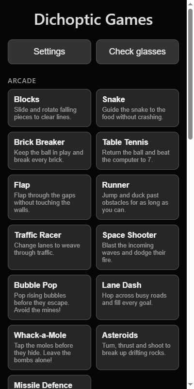
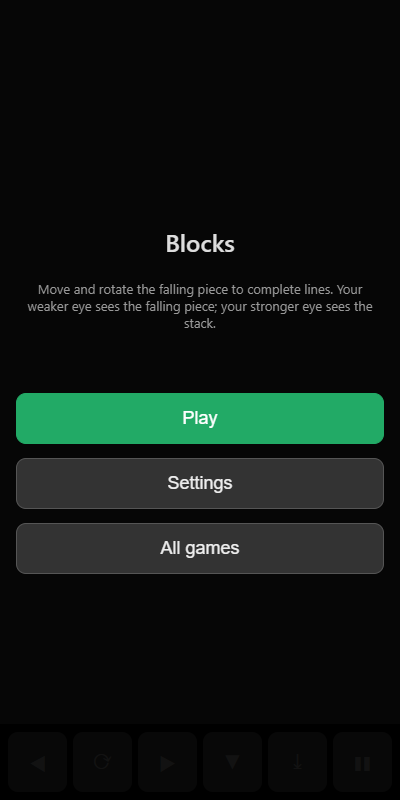
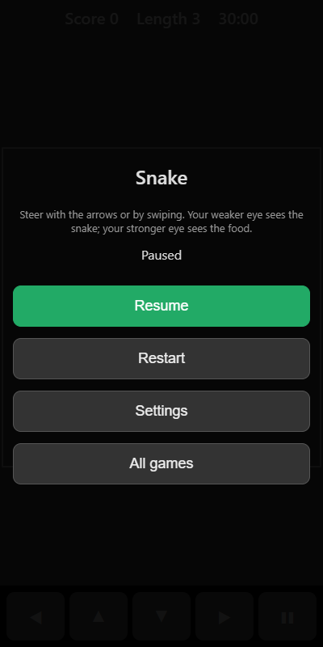
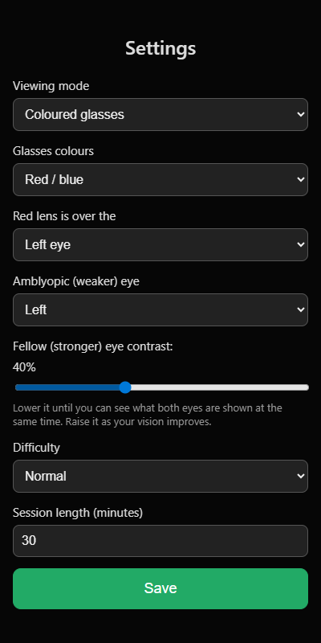
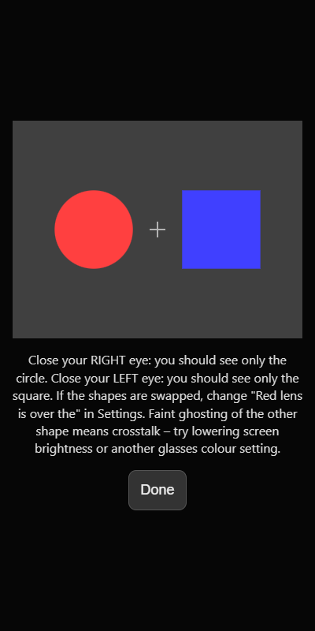
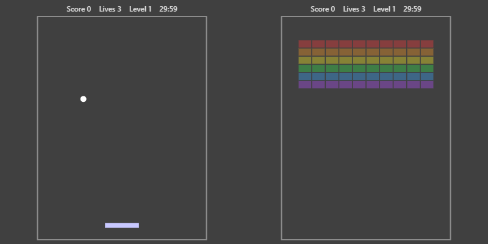

Games on your phone, set up as dichoptic exercises. Each eye sees a different part of the game, so the two eyes have to work together to play.

There are 51 games in four groups (arcade, puzzles, strategy and words), so you can switch between them to keep sessions varied.

> [!IMPORTANT]
> Play now at **<https://onesixtyfourth.github.io/dichoptic-games/>**

> [!CAUTION]
> This app is not a medical device. Use it only as directed by your orthoptist or eye-care professional, and follow their advice on contrast settings and session length.

## How it works

Every game splits what you see between your two eyes. The things you need to react to are shown to the amblyopic (weaker) eye at full contrast. The rest of the game is shown to the fellow (stronger) eye at reduced contrast. The border, top bar and timer are shown to both eyes to help them combine the two images.

To play well you need information from both eyes at the same time. Lowering the contrast for the stronger eye stops it from dominating, which encourages the weaker eye to take part.

## Games

Every game has its own page with a full description, how to play, controls, what each eye sees, what the difficulty setting changes, scoring and tips. Start from a category page to see all its games side by side.

| Category                             | Games | What they're like                                    |
|--------------------------------------|-------|------------------------------------------------------|
| [Arcade](docs/arcade/README.md)      | 18    | Fast, real-time games where you react to moving objects |
| [Puzzles](docs/puzzles/README.md)    | 18    | Thinking games played at your own pace               |
| [Strategy](docs/strategy/README.md)  | 11    | Board and card games against the computer            |
| [Words](docs/words/README.md)        | 4     | Letter and word games with themed word lists         |

### Arcade

[Blocks](docs/arcade/blocks.md), [Snake](docs/arcade/snake.md), [Brick Breaker](docs/arcade/brick-breaker.md), [Table Tennis](docs/arcade/table-tennis.md), [Flap](docs/arcade/flap.md), [Runner](docs/arcade/runner.md), [Traffic Racer](docs/arcade/traffic-racer.md), [Space Shooter](docs/arcade/space-shooter.md), [Bubble Pop](docs/arcade/bubble-pop.md), [Lane Dash](docs/arcade/lane-dash.md), [Whack-a-Mole](docs/arcade/whack-a-mole.md), [Asteroids](docs/arcade/asteroids.md), [Missile Defence](docs/arcade/missile-defence.md), [Shape Hero](docs/arcade/shape-hero.md), [Chaser](docs/arcade/chaser.md), [Eclipse Runner](docs/arcade/eclipse-runner.md), [Bouncer](docs/arcade/bouncer.md), [Pinball](docs/arcade/pinball.md)

### Puzzles

[Maze](docs/puzzles/maze.md), [Memory Match](docs/puzzles/memory-match.md), [Sliding Puzzle](docs/puzzles/sliding-puzzle.md), [2048](docs/puzzles/2048.md), [Sudoku](docs/puzzles/sudoku.md), [Mine Sweeper](docs/puzzles/mine-sweeper.md), [Bubble Shooter](docs/puzzles/bubble-shooter.md), [Link Pairs](docs/puzzles/link-pairs.md), [Spot the Difference](docs/puzzles/spot-the-difference.md), [Shape Sort](docs/puzzles/shape-sort.md), [Simon](docs/puzzles/simon.md), [Mahjong Solitaire](docs/puzzles/mahjong-solitaire.md), [Shape Crush](docs/puzzles/shape-crush.md), [Picture Logic](docs/puzzles/picture-logic.md), [Lights Out](docs/puzzles/lights-out.md), [Code Breaker](docs/puzzles/code-breaker.md), [Flowgrid](docs/puzzles/flowgrid.md), [Prism](docs/puzzles/prism.md)

### Strategy

[Tic Tac Toe](docs/strategy/tic-tac-toe.md), [Four in a Row](docs/strategy/four-in-a-row.md), [Gomoku](docs/strategy/gomoku.md), [Solitaire](docs/strategy/solitaire.md), [Reversi](docs/strategy/reversi.md), [Checkers](docs/strategy/checkers.md), [Battleships](docs/strategy/battleships.md), [Dots and Boxes](docs/strategy/dots-and-boxes.md), [Mancala](docs/strategy/mancala.md), [Chess](docs/strategy/chess.md), [Tower Defence](docs/strategy/tower-defence.md)

### Words

[Word Search](docs/words/word-search.md), [Word Guess](docs/words/word-guess.md), [Hangman](docs/words/hangman.md), [Word Loom](docs/words/word-loom.md)

## Using the app

The home screen lists every game by category. Tap a game to open its menu.



The game menu shows a short reminder of how to play and your best score. Tap **Play** to start, **Settings** to change settings, or **All games** to go back to the list.



While you're playing, **❚❚** pauses the game. From the pause menu you can resume, restart, change settings or go back to the list of games.



Your best score for each game is saved on your phone and shown in the game menu.

## What you need

* A phone with a modern browser (Chrome, Safari, Edge or Firefox)
* One of the following:
  * Red/blue, red/cyan or red/green anaglyph glasses
  * A VR phone viewer (for example Google Cardboard) plus a Bluetooth game controller or keyboard

## Getting started

1. Open <https://onesixtyfourth.github.io/dichoptic-games/> on your phone.
2. Optionally install it as an app:
   * On Android (Chrome), open the menu and choose **Add to Home screen** or **Install app**.
   * On iPhone (Safari), tap **Share** then **Add to Home Screen**.
3. Tap **Settings** and set your viewing mode, glasses colours, which side the red lens is on, and which eye is your amblyopic eye. Tap **Save**.
4. Tap **Check glasses** and confirm the colours match your glasses (see [Checking your glasses](#checking-your-glasses)).
5. Put your glasses on, pick a game and tap **Play**.

Once installed, the app works offline. Settings are saved on your phone.

When you open the app with an internet connection it always loads the latest version. Without a connection it uses the last version it downloaded.

## Settings



| Setting                          | Description                                                                                                  |
|----------------------------------|--------------------------------------------------------------------------------------------------------------|
| Viewing mode                     | **Coloured glasses** for anaglyph glasses, or **Split screen (VR viewer)** for a headset                     |
| Glasses colours                  | Red/blue (default), red/cyan or red/green. Match the lenses you own                                          |
| Red lens is over the             | Left or right eye. Most glasses have red on the left                                                         |
| Amblyopic (weaker) eye           | The eye that sees the parts of the game you react to                                                         |
| Fellow (stronger) eye contrast   | How visible the stronger eye's part of the game is (5% to 100%, default 40%)                                 |
| Difficulty                       | Easy, Normal or Hard. Changes speed, board size or how well the computer plays, depending on the game         |
| Session length (minutes)         | Play time before the session ends automatically (default 30)                                                 |

### Choosing the contrast

Start with the contrast your orthoptist recommends. If you have no recommendation, lower the fellow-eye contrast until you can see what both eyes are shown at the same time. As your vision improves, raise it gradually towards 100%.

You can pause a game, open **Settings**, change the contrast or difficulty and resume. Difficulty changes apply when you next start a game.

## Checking your glasses

**Check glasses** shows a circle to the left eye only and a square to the right eye only.



1. Close your right eye. You should see only the circle.
2. Close your left eye. You should see only the square.

If the shapes are swapped, change **Red lens is over the** in Settings. If you can faintly see the other shape (ghosting), try lowering your screen brightness or choosing a different **Glasses colours** option. A small cross in the middle is shown to both eyes.

## Controls

### Touch

The buttons along the bottom of the screen change to suit each game. Most games can also be played by tapping, dragging or swiping on the game itself. **❚❚** always pauses the game and gives you options to resume, restart, change settings or return to the list of games.

In split-screen mode the on-screen buttons are hidden. In games that don't use taps, tapping the screen (or the button on a Cardboard viewer) pauses the game.

### Keyboard

| Key                  | Action                                        |
|----------------------|-----------------------------------------------|
| Arrow keys           | Move, steer or move the selection             |
| Space or Enter       | Main action (the ● button, or the game's labelled button) |
| X                    | Second action (the ◆ button)                  |
| P or Escape          | Pause                                         |
| Letters and numbers  | Typing in Word Guess and Sudoku               |

### Game controller

| Button              | Action          |
|---------------------|-----------------|
| D-pad or left stick | Arrow keys      |
| A                   | Main action     |
| B                   | Second action   |
| Start               | Play or pause   |

## Sessions

The time on the right of the top bar shows how long is left in the current session. It only counts down while you are playing and carries on across games. When it reaches zero the game stops. Starting a game after that begins a fresh session.

Games pause automatically if you switch apps or lock the phone, and the screen stays awake while you play.

## Split screen (VR viewer) mode

1. Pair a Bluetooth game controller or keyboard with your phone.
2. Select **Split screen (VR viewer)** in Settings and tap **Save**.
3. Pick a game and tap **Play**. The game goes full screen and switches to landscape where the phone allows it.
4. Place the phone in the viewer.

The left half of the screen is shown to the left eye and the right half to the right eye. Games keep their normal colours in this mode.



Arcade games and games with a cursor work best with a controller. Bubble Pop, Word Search, Solitaire and Spot the Difference need touch, and Word Guess needs touch or a keyboard.

## Running locally

The app is plain HTML, CSS and JavaScript with no build step. Serve the folder with any static web server, for example:

```powershell
py -m http.server 8080
```

Then open `http://localhost:8080`. Offline support and screen wake lock need HTTPS (or `localhost`), so use the GitHub Pages address when playing on a phone.

## Files

| File                   | Purpose                                                      |
|------------------------|--------------------------------------------------------------|
| `index.html`           | Page layout, game list, menus and settings form              |
| `style.css`            | Styling                                                      |
| `js/core.js`           | Dichoptic rendering, input, menus, sessions and best scores  |
| `js/games/arcade.js`   | Arcade games                                                 |
| `js/games/puzzles.js`  | Puzzle games                                                 |
| `js/games/strategy.js` | Strategy games                                               |
| `js/games/words.js`    | Word games                                                   |
| `sw.js`                | Service worker for offline use                               |
| `manifest.webmanifest` | App manifest for installing to home screen                   |
| `icon.svg`             | App icon                                                     |
| `docs/`                | Category and game pages, with screenshots                    |

## Adding a game

Each game calls `DG.register()` with its name, category, help text, on-screen buttons and a `create(api)` function. The returned object provides `update`, `draw`, `action`, `pointer` and `hud` as needed. Drawing goes through the renderer passed to `draw`, where every shape names its target: `'amb'` (weaker eye), `'fellow'` (stronger eye) or `'both'`. Add any new script file to `index.html` and to the asset list in `sw.js`. Then add a page for the game under `docs/<category>/`, with a screenshot in that folder's `images/`, and link it from the category page and this README.
