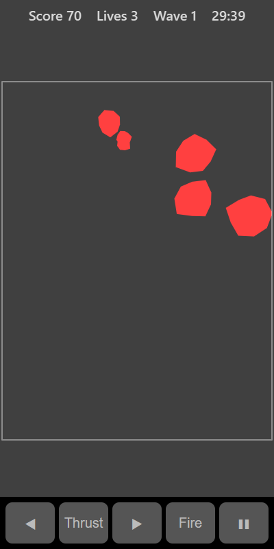

[Home](../../README.md) > [Arcade](README.md) > Asteroids

In Asteroids you pilot a small ship in a field of drifting rocks. Shoot the rocks to break them up. Big rocks split into two medium rocks, medium rocks split into two small ones, and small rocks are destroyed. Clear every rock to start the next wave.

## How to play

1. Tap **Play**. Your ship starts in the middle, pointing up.
2. Turn the ship to aim and fire at the rocks.
3. Thrust to move. The ship keeps drifting and slows down gradually.
4. Anything that leaves one edge of the screen comes back on the opposite edge.
5. Touching a rock costs a life and puts you back in the middle. You have 3 lives. Your ship flashes for a moment while it can't be hurt.
6. Each wave starts with more rocks than the last.

## Controls

| Action   | Touch          | Keyboard       | Controller  |
|----------|----------------|----------------|-------------|
| Turn     | Hold ◀ or ▶    | Left and Right | D-pad       |
| Thrust   | Hold **Thrust**| Up             | D-pad up    |
| Fire     | Hold **Fire**  | Space or Enter | A           |
| Pause    | ❚❚             | P or Escape    | Start       |

## What each eye sees

| Weaker eye | Stronger eye             | Both eyes      |
|------------|--------------------------|----------------|
| The rocks  | Your ship and its shots  | The board edge |

## Difficulty

Higher settings add an extra rock to each wave and make the rocks move faster.

## Scoring

| Rock size | Points |
|-----------|--------|
| Large     | 20     |
| Medium    | 50     |
| Small     | 100    |

The top bar shows your score, lives and wave.

## Tips

* You don't have to move much. Turning and firing from the middle is often safest.
* Breaking a big rock makes more, faster pieces. Clear up the small ones before breaking the next big one.
