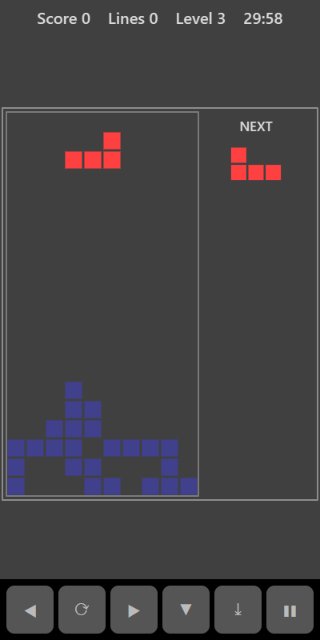

[Home](../../README.md) > [Arcade](README.md) > Blocks

Blocks is a falling-piece puzzle. Pieces made of four squares drop into a well 10 squares wide and 20 tall. Slide and rotate each piece so it fills gaps in the stack below. Every row you fill completely disappears and scores points.

## How to play

1. Tap **Play**. A piece appears at the top of the well and starts to fall.
2. Move it left or right and rotate it until it is lined up where you want it.
3. Let it fall, push it down faster, or drop it straight to the bottom.
4. When a piece lands it joins the stack and the next piece (shown under **NEXT**) appears.
5. Fill a whole row from wall to wall to clear it. Rows above move down.
6. The game ends when a new piece has no room to appear at the top.

## Controls

| Action      | Touch | Keyboard       | Controller   |
|-------------|-------|----------------|--------------|
| Move        | ◀ ▶   | Left and Right | D-pad        |
| Rotate      | ⟳     | Up or X        | D-pad up, B  |
| Soft drop   | ▼     | Down           | D-pad down   |
| Hard drop   | ⤓     | Space or Enter | A            |
| Pause       | ❚❚    | P or Escape    | Start        |

Holding ◀, ▶ or ▼ repeats the move.

## What each eye sees

| Weaker eye                             | Stronger eye                 | Both eyes        |
|----------------------------------------|------------------------------|------------------|
| The falling piece and the next piece   | The stack of landed blocks   | The well outline |

To place a piece neatly you have to judge where the falling piece (weaker eye) sits against the stack (stronger eye).

## Difficulty

| Setting | Starting level |
|---------|----------------|
| Easy    | 1              |
| Normal  | 3              |
| Hard    | 6              |

Pieces fall faster at each level. You go up a level for every 10 lines you clear.

## Scoring

| Lines cleared at once | Points          |
|-----------------------|-----------------|
| 1                     | 100 × level     |
| 2                     | 300 × level     |
| 3                     | 500 × level     |
| 4                     | 800 × level     |

The top bar shows your score, lines cleared and level.

## Tips

* Keep the stack flat and leave one column open for the long straight piece, so you can clear four lines at once.
* Look at the **NEXT** piece to plan where the current one should go.
* Use hard drop once a piece is lined up to save time at higher levels.
