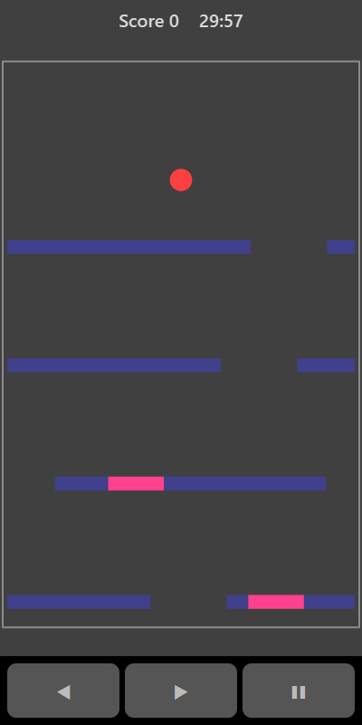

[Home](../../README.md) > [Arcade](README.md) > Bouncer

Bouncer has a ball bouncing on a tower of platforms. Each platform has a gap in it. You can't move the ball, but you can slide all the platforms sideways. Line a gap up under the ball to let it drop to the next platform. Red sections are dangerous. If the ball lands on one, the game ends.

## How to play

1. Tap **Play**. The ball starts bouncing on the first platform.
2. Drag left or right to slide the platforms. They wrap round, so anything that slides off one side comes back on the other.
3. Line up a gap under the ball and it drops through to the next platform.
4. The ball bounces when it lands on a normal blue section.
5. Keep the ball away from red sections. Landing on one ends the game.
6. Drop through three gaps in a row without bouncing and the ball glows. It smashes through the next platform it lands on, even a red section.
7. Red sections become more common the further down you go.

## Controls

| Action              | Touch                          | Keyboard        | Controller |
|---------------------|--------------------------------|-----------------|------------|
| Slide the platforms | Drag sideways, or hold ◀ ▶     | Left and Right  | D-pad      |
| Pause               | ❚❚                             | P or Escape     | Start      |

## What each eye sees

| Weaker eye                    | Stronger eye    | Both eyes      |
|-------------------------------|-----------------|----------------|
| The ball and the red sections | The platforms   | The board edge |

To find a safe landing you have to see the platforms (stronger eye) and the red sections on them (weaker eye) at the same time.

## Difficulty

| Setting | Gap size | Red sections         |
|---------|----------|----------------------|
| Easy    | Widest   | Fewest               |
| Normal  | Medium   | More                 |
| Hard    | Narrowest | Most                 |

## Scoring

Each gap you drop through scores points equal to how many gaps in a row you have dropped through. One gap scores 1, the next in the same fall scores 2, and so on. The top bar shows your score and, during a run of drops, the combo.

## Tips

* Slide the next gap into place while the ball is still in the air.
* Long falls score far more than single drops, so try to line up gaps on the platforms below as well.
