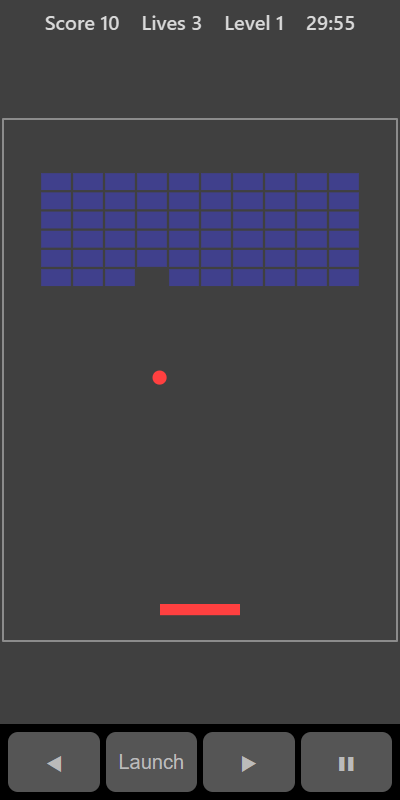

[Home](../../README.md) > [Arcade](README.md) > Brick Breaker

Brick Breaker has six rows of coloured bricks at the top of the screen and your paddle at the bottom. Bounce the ball off the paddle to knock out the bricks. Don't let the ball fall past you.

## How to play

1. Tap **Play**. The ball sits on your paddle.
2. Tap the board or press **Launch** to serve.
3. Move the paddle under the ball to bounce it back up.
4. Where the ball hits the paddle changes its angle. Hitting near an edge sends it off sideways.
5. Each brick the ball touches breaks.
6. Clear all 60 bricks to move to the next level. The bricks come back and the ball is a little faster.
7. If the ball falls past your paddle you lose a life. You have 3 lives.

## Controls

| Action       | Touch                              | Keyboard       | Controller |
|--------------|------------------------------------|----------------|------------|
| Move paddle  | ◀ ▶ or drag on the board           | Left and Right | D-pad      |
| Launch       | **Launch** or tap the board        | Space or Enter | A          |
| Pause        | ❚❚                                 | P or Escape    | Start      |

## What each eye sees

| Weaker eye          | Stronger eye | Both eyes      |
|---------------------|--------------|----------------|
| The ball and paddle | The bricks   | The board edge |

## Difficulty

| Setting | Paddle width | Ball speed |
|---------|--------------|------------|
| Easy    | Widest       | Slowest    |
| Normal  | Medium       | Medium     |
| Hard    | Narrowest    | Fastest    |

## Scoring

Each brick is worth 10 points multiplied by the level. The top bar shows your score, lives and level.

## Tips

* Aim for the edges of the brick wall. Once you break through, the ball can bounce around above the bricks and clear lots of them for you.
* Keep your eyes on the ball, not the paddle, and let the paddle follow.
