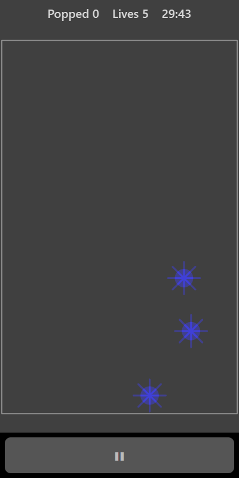

[Home](../../README.md) > [Arcade](README.md) > Bubble Pop

Bubbles float up from the bottom of the screen. Tap them to pop them before they escape off the top. Some of the rising objects are spiky mines. Leave those alone.

## How to play

1. Tap **Play**. Bubbles start rising from the bottom.
2. Tap a bubble to pop it.
3. Every bubble that escapes off the top costs a life.
4. Tapping a mine also costs a life. Mines that float away do no harm.
5. You have 5 lives. Bubbles rise faster and appear more often as time goes on.

## Controls

| Action | Touch                 | Keyboard    | Controller |
|--------|-----------------------|-------------|------------|
| Pop    | Tap a bubble          | None        | None       |
| Pause  | ❚❚                    | P or Escape | Start      |

Bubble Pop needs touch, so it can't be played in split-screen mode with a controller.

## What each eye sees

| Weaker eye  | Stronger eye | Both eyes      |
|-------------|--------------|----------------|
| The bubbles | The mines    | The board edge |

You need both eyes to tell a safe bubble from a mine in the same spot.

## Difficulty

| Setting | Chance that a new object is a mine |
|---------|------------------------------------|
| Easy    | 15%                                |
| Normal  | 22%                                |
| Hard    | 30%                                |

## Scoring

One point for each bubble popped. The top bar shows how many you have popped and your lives.

## Tips

* Pop bubbles while they are low on the screen so you have time for the next ones.
* Check what you are about to tap. A mine and a bubble can be close together.
