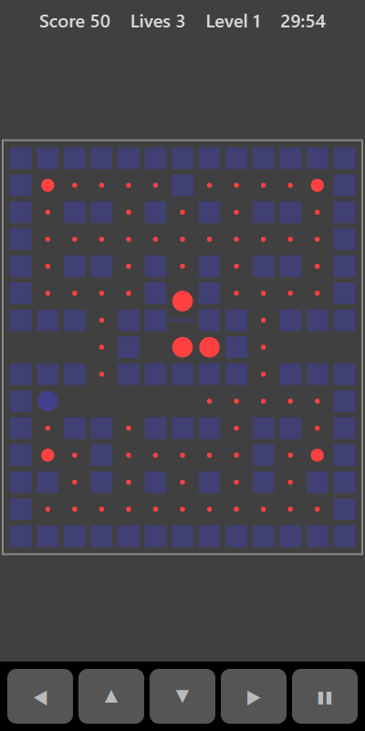

[Home](../../README.md) > [Arcade](README.md) > Chaser

Chaser is a maze game. Steer around the maze collecting every spark while the chasers hunt you down. Eat one of the four big sparks and the chasers turn into rings and run away. For a few seconds you can catch them for bonus points. Clear every spark to move to a faster level.

## How to play

1. Tap **Play**. You start in the lower middle of the maze. The chasers start in their house in the centre and come out one at a time.
2. Steer through the corridors. You keep moving in a direction until you hit a wall or turn.
3. Run over sparks to collect them.
4. The gap at each end of the middle row is a tunnel. Go through one side and you come out on the other.
5. Eat a big spark (one near each corner) and the chasers turn into rings. Catch them before they change back. They flash when time is nearly up.
6. Touching a chaser that isn't a ring costs a life and puts everyone back to the start. You have 3 lives.
7. Collect every spark to start the next level. Everything moves a little faster each level.

## Controls

| Action | Touch                          | Keyboard    | Controller |
|--------|--------------------------------|-------------|------------|
| Steer  | ◀ ▲ ▼ ▶ or swipe on the board  | Arrow keys  | D-pad      |
| Pause  | ❚❚                             | P or Escape | Start      |

You can press a direction just before a junction and you will turn as soon as there's an opening.

## What each eye sees

| Weaker eye                | Stronger eye        | Both eyes      |
|---------------------------|---------------------|----------------|
| The chasers and sparks    | You and the maze    | The board edge |

You need your stronger eye to find your way and your weaker eye to see where the danger and the sparks are.

## Difficulty

| Setting | Chasers | How hard they chase                  |
|---------|---------|--------------------------------------|
| Easy    | 2       | Slower and often wander              |
| Normal  | 3       | Medium speed and mostly chase you    |
| Hard    | 3       | Fastest and almost always chase you  |

Big sparks also scare the chasers for less time on higher settings.

## Scoring

| Event                                  | Points               |
|----------------------------------------|----------------------|
| Spark                                  | 10                   |
| Big spark                              | 50                   |
| Catching chasers after one big spark   | 200, 400, 800 in turn |

The top bar shows your score, lives and level.

## Tips

* Save the big sparks until chasers are close by, then turn on them.
* Use the tunnel to escape. Chasers can follow you, but it gives you room.
* Clear one area at a time rather than leaving single sparks scattered around.
