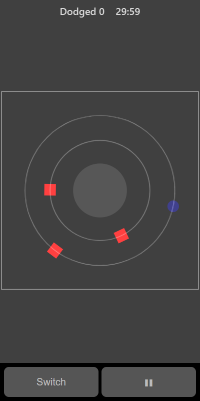

[Home](../../README.md) > [Arcade](README.md) > Eclipse Runner

In Eclipse Runner you run round a ring by yourself, clockwise, on one of two tracks. Blocks sit on the tracks ahead of you. Jump between the inner and outer track to dodge them. The longer you last, the faster you run.

## How to play

1. Tap **Play**. You start on the outer track at the top of the ring.
2. Blocks appear on the tracks ahead of you.
3. Tap to jump to the other track when a block is coming up on yours.
4. Each block you get past scores a point.
5. The game ends if you run into a block.

## Controls

| Action        | Touch                         | Keyboard                    | Controller |
|---------------|-------------------------------|-----------------------------|------------|
| Switch track  | Tap anywhere, or **Switch**   | Space, Enter, Up or Down    | A, D-pad   |
| Pause         | ❚❚                            | P or Escape                 | Start      |

## What each eye sees

| Weaker eye | Stronger eye | Both eyes                    |
|------------|--------------|------------------------------|
| The blocks | You          | The two tracks and the centre |

To dodge you need to judge where you are (stronger eye) against the blocks coming towards you (weaker eye).

## Difficulty

| Setting | Starting speed | Blocks       |
|---------|----------------|--------------|
| Easy    | Slow           | Spread out   |
| Normal  | Medium         | Medium       |
| Hard    | Fast           | Close together |

There is always room to switch tracks between one block and the next.

## Scoring

One point for every block you get past. The top bar shows how many you have dodged.

## Tips

* Look a quarter of the way round the ring ahead of you, not at your runner.
* Switch early. You don't have to wait until the block is right in front of you.
