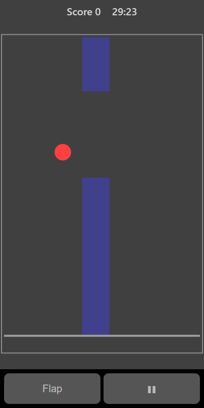

[Home](../../README.md) > [Arcade](README.md) > Flap

In Flap you guide a bird past an endless line of walls. Gravity pulls the bird down and each flap lifts it up. Get through the gap in each wall without touching it or the ground.

## How to play

1. Tap **Play**. The bird waits until you flap for the first time.
2. Tap the board or press **Flap** to rise. Stop flapping to fall.
3. Walls slide in from the right. Each one has a gap.
4. Fly through the gap. You score a point for each wall you pass.
5. The game ends if the bird touches a wall or the ground. Flying into the top of the screen just stops you rising.

## Controls

| Action | Touch                       | Keyboard                 | Controller |
|--------|-----------------------------|--------------------------|------------|
| Flap   | **Flap** or tap the board   | Space, Enter or Up       | A          |
| Pause  | ❚❚                          | P or Escape              | Start      |

## What each eye sees

| Weaker eye | Stronger eye | Both eyes  |
|------------|--------------|------------|
| The bird   | The walls    | The ground |

## Difficulty

| Setting | Gap size | Wall speed |
|---------|----------|------------|
| Easy    | Largest  | Slowest    |
| Normal  | Medium   | Medium     |
| Hard    | Smallest | Fastest    |

## Scoring

One point for each wall you pass. The top bar shows your score.

## Tips

* Small, regular taps keep the bird steady. Big bursts make it hard to control.
* Line up with the next gap early rather than at the last moment.
