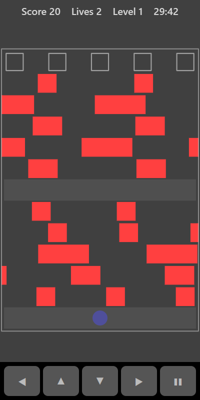

[Home](../../README.md) > [Arcade](README.md) > Lane Dash

Lane Dash is a road-crossing game. Start at the bottom and hop one square at a time across lanes of moving traffic. There is a safe strip halfway up. Reach one of the five goals along the top, then go back for the next. Fill all five to move to a faster level.

## How to play

1. Tap **Play**. You start on the safe strip at the bottom.
2. Hop forward when there is a gap in the traffic.
3. Rest on the middle strip if you need to.
4. Land in an empty goal square at the top. A filled goal shows a green dot.
5. You go back to the start after each goal.
6. You lose a life if a car hits you, or if you hop into the top row anywhere other than an empty goal. You have 3 lives.
7. When all five goals are filled you move up a level and the traffic gets faster.

## Controls

| Action | Touch                                  | Keyboard    | Controller |
|--------|----------------------------------------|-------------|------------|
| Hop    | ◀ ▲ ▼ ▶ or swipe on the board          | Arrow keys  | D-pad      |
| Pause  | ❚❚                                     | P or Escape | Start      |

## What each eye sees

| Weaker eye  | Stronger eye                     | Both eyes                    |
|-------------|----------------------------------|------------------------------|
| The traffic | You and the filled goals         | Safe strips and goal outlines |

## Difficulty

The traffic is faster on higher difficulty settings and gets faster again at each level.

## Scoring

| Event                         | Points |
|-------------------------------|--------|
| Each new row you reach        | 10     |
| Landing in a goal             | 100    |
| Filling all five goals        | 500    |

The top bar shows your score, lives and level.

## Tips

* Lanes next to each other move in opposite directions. Watch both before you hop.
* You can hop sideways or back to dodge a car.
