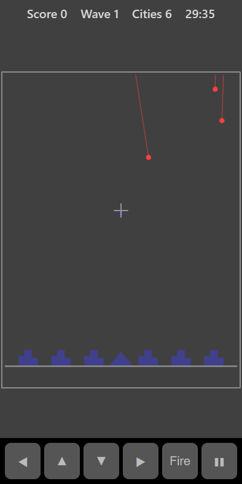

[Home](../../README.md) > [Arcade](README.md) > Missile Defence

Missiles fall from the top of the screen towards your six cities. Tap the sky to send up an interceptor from your base. It explodes where you tapped and destroys any missiles caught in the blast. Survive as many waves as you can.

## How to play

1. Tap **Play**. The first wave of missiles starts to fall.
2. Tap just ahead of a missile so it flies into the blast.
3. Each blast grows for a moment and then fades.
4. A missile that reaches the ground destroys any city it lands on.
5. When a wave ends you get bonus points for every city still standing, and the next wave starts with more, faster missiles.
6. The game ends when all six cities are destroyed.

## Controls

| Action           | Touch                | Keyboard       | Controller |
|------------------|----------------------|----------------|------------|
| Fire             | Tap the sky          | Space or Enter | A          |
| Move the target  | None                 | Arrow keys     | D-pad      |
| Pause            | ❚❚                   | P or Escape    | Start      |

With a keyboard or controller, move the white cross and press **Fire** to send an interceptor to it.

## What each eye sees

| Weaker eye                 | Stronger eye                                    | Both eyes                 |
|----------------------------|-------------------------------------------------|---------------------------|
| The missiles and trails    | Your cities, base, interceptors and blasts      | The ground and the cross  |

To time a shot you need to judge where a missile (weaker eye) will meet your blast (stronger eye).

## Difficulty

Missiles fall faster on higher settings, and faster again with each wave.

## Scoring

| Event                             | Points |
|-----------------------------------|--------|
| Each missile destroyed            | 25     |
| Each city left at the end of a wave | 100  |

The top bar shows your score, wave and cities left.

## Tips

* One well-placed blast can catch several missiles that are close together.
* You can only fire a few times a second, so don't waste shots on missiles heading for empty ground.
