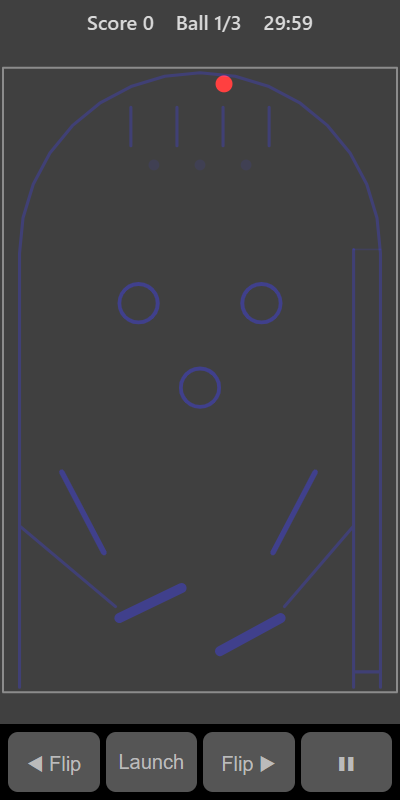

[Home](../../README.md) > [Arcade](README.md) > Pinball

Pinball is a classic flipper table. Launch the ball up the lane on the right, then use the two flippers at the bottom to keep it in play. Hit bumpers, slingshots and the lanes at the top to score. If the ball falls between the flippers it drains and you lose it. You have three balls.

## How to play

1. Tap **Play**. The ball waits at the bottom of the launch lane on the right.
2. Tap the table or press **Launch** to fire it up the lane and onto the table.
3. Raise a flipper to hit the ball as it comes down. Hold it up to trap the ball and line up a shot.
4. Score points by hitting the round bumpers, the slingshots above the flippers and the three lanes at the top.
5. Light all three top lanes to raise your score multiplier, up to × 5.
6. If the ball drains between the flippers you lose it. The multiplier resets with each new ball.
7. The game ends when all three balls are gone.

## Table features

| Feature         | Where                         | Points        | What it does                                         |
|-----------------|-------------------------------|---------------|------------------------------------------------------|
| Bumpers         | The three rings in the middle | 100           | Kick the ball away hard                              |
| Slingshots      | The slanted bars above each flipper | 10      | Give the ball an extra push                          |
| Top lanes       | The three gaps at the very top | 50 each      | A light below each lane shows when it's lit          |
| All lanes lit   |                               | 500 bonus     | Raises the multiplier by one and resets the lights   |
| Launch gate     | Top of the launch lane        |               | Lets the ball out of the lane but stops it falling back in |

All points are multiplied by the current multiplier.

## Ball saver

If the ball drains very soon after you launch it, you get it back once. You get this once for each ball.

## Controls

| Action          | Touch                                          | Keyboard        | Controller |
|-----------------|------------------------------------------------|-----------------|------------|
| Left flipper    | Hold **◀ Flip**, or hold the left half of the table  | Hold Left  | Hold D-pad left  |
| Right flipper   | Hold **Flip ▶**, or hold the right half of the table | Hold Right | Hold D-pad right |
| Launch          | **Launch**, or tap the table                   | Space, Enter or Up | A       |
| Pause           | ❚❚                                             | P or Escape     | Start      |

The **◀ Flip** and **Flip ▶** buttons let you use both flippers at once.

## What each eye sees

| Weaker eye | Stronger eye                                        | Both eyes                      |
|------------|-----------------------------------------------------|--------------------------------|
| The ball   | The walls, flippers, bumpers, slingshots and lights | Messages such as "Ball saved"  |

Timing a flip means judging where the ball (weaker eye) is in relation to the flippers (stronger eye).

## Difficulty

| Setting | Table slope (ball speed) | Flipper length | Ball saver   |
|---------|--------------------------|----------------|--------------|
| Easy    | Gentle                   | Longest        | 15 seconds   |
| Normal  | Medium                   | Medium         | 8 seconds    |
| Hard    | Steep                    | Shortest       | None         |

## Scoring

The top bar shows your score, which ball you are on, and the multiplier when it is above × 1.

## Tips

* Don't flip too early. Let the ball come down to the middle of the flipper.
* Hold a flipper up to catch the ball, then let it roll down and flip at the right moment to aim.
* Hitting the ball near the tip of a flipper sends it across the table; near the base sends it up the same side.
