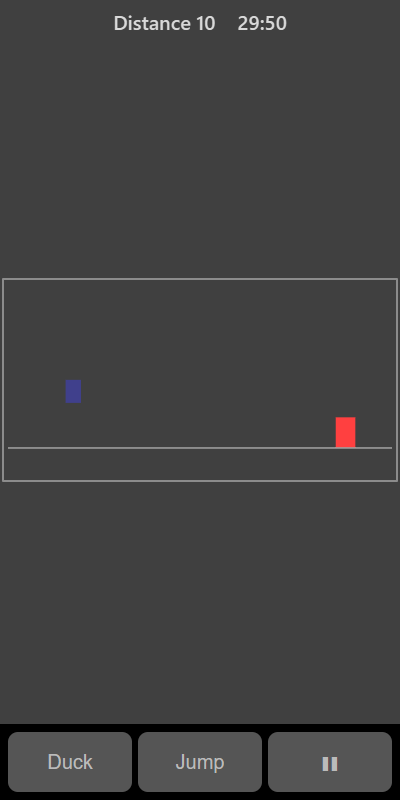

[Home](../../README.md) > [Arcade](README.md) > Runner

Runner is an endless run. Your runner keeps moving and obstacles come towards you. Jump over the blocks on the ground and, once you have gone far enough, duck under the flying obstacles too. The run gets faster the further you go.

## How to play

1. Tap **Play**. The runner sets off straight away.
2. Jump over the blocks on the ground.
3. After a distance of 150, diamond-shaped flyers start to appear at head height. Duck under them, or time a jump over them.
4. The game ends if you touch any obstacle.

## Controls

| Action | Touch                       | Keyboard              | Controller |
|--------|-----------------------------|-----------------------|------------|
| Jump   | **Jump** or tap the board   | Space, Enter or Up    | A          |
| Duck   | Hold **Duck**               | Hold Down             | D-pad down |
| Pause  | ❚❚                          | P or Escape           | Start      |

You can only jump from the ground and only duck while on the ground.

## What each eye sees

| Weaker eye                 | Stronger eye | Both eyes  |
|----------------------------|--------------|------------|
| The blocks and the flyers  | The runner   | The ground |

## Difficulty

| Setting | Starting speed |
|---------|----------------|
| Easy    | Slow           |
| Normal  | Medium         |
| Hard    | Fast           |

Speed keeps rising slowly whatever the setting.

## Scoring

Your score is the distance you run. The top bar shows the distance so far.

## Tips

* Jump a little early for tall blocks.
* When a flyer comes, holding **Duck** is safer than jumping.
