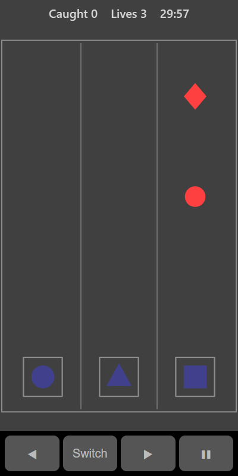

[Home](../../README.md) > [Arcade](README.md) > Shape Hero

Shape Hero has a row of lanes, each with a catcher at the bottom. Shapes fall down the lanes. Before a shape reaches the bottom, switch that lane's catcher to the same shape so it is caught. The shapes fall faster and more often the longer you play.

## How to play

1. Tap **Play**. Each lane's catcher starts with a different shape.
2. Watch the shapes falling down the lanes.
3. Tap a lane to switch its catcher to the next shape. Keep tapping until it matches the shape coming down that lane.
4. A shape that lands on a matching catcher is caught and a white ring flashes.
5. A shape that lands on the wrong catcher costs a life and a red cross flashes. You have 3 lives.

## Controls

| Action                  | Touch          | Keyboard       | Controller |
|-------------------------|----------------|----------------|------------|
| Switch a catcher        | Tap the lane   | Space or Enter | A          |
| Choose a lane           | ◀ ▶            | Left and Right | D-pad      |
| Pause                   | ❚❚             | P or Escape    | Start      |

With a keyboard or controller, a white square shows which catcher **Switch** changes.

## What each eye sees

| Weaker eye          | Stronger eye  | Both eyes                            |
|---------------------|---------------|--------------------------------------|
| The falling shapes  | The catchers  | Lane lines, catcher frames and flashes |

To make a match you have to compare a falling shape (weaker eye) with its catcher (stronger eye).

## Difficulty

| Setting | Lanes | Kinds of shape | Starting speed |
|---------|-------|----------------|----------------|
| Easy    | 3     | 3              | Slow           |
| Normal  | 3     | 4              | Medium         |
| Hard    | 4     | 5              | Fast           |

## Scoring

One point for each shape caught. The top bar shows how many you have caught and your lives.

## Tips

* Switch a catcher as soon as a new shape appears in its lane, not at the last moment.
* The catchers cycle through the shapes in the same order every time. Learn the order so you know how many taps you need.
