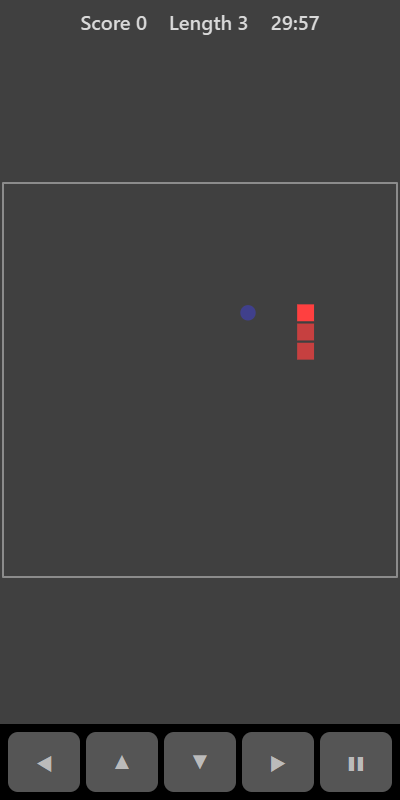

[Home](../../README.md) > [Arcade](README.md) > Snake

Snake takes place on a 20 by 20 grid. Your snake moves forward on its own, one square at a time. Steer it to the food. Each piece of food makes the snake one square longer, so the board gets more crowded as you go.

## How to play

1. Tap **Play**. The snake starts in the middle of the board moving right.
2. Turn the snake towards the food.
3. Eating food scores 10 points and adds a square to the snake's tail.
4. The game ends if the snake hits a wall or runs into its own body.
5. If the snake ever fills the whole board, you win.

## Controls

| Action | Touch                          | Keyboard    | Controller |
|--------|--------------------------------|-------------|------------|
| Turn   | ◀ ▲ ▼ ▶ or swipe on the board  | Arrow keys  | D-pad      |
| Pause  | ❚❚                             | P or Escape | Start      |

You cannot reverse straight back on yourself. Quick turns are remembered, so you can press two directions in a row to make a U-turn.

## What each eye sees

| Weaker eye | Stronger eye | Both eyes      |
|------------|--------------|----------------|
| The snake  | The food     | The board edge |

## Difficulty

| Setting | Speed                    |
|---------|--------------------------|
| Easy    | One step every 0.16 s    |
| Normal  | One step every 0.12 s    |
| Hard    | One step every 0.09 s    |

## Scoring

Each piece of food is worth 10 points. The top bar shows your score and the snake's length.

## Tips

* Stay away from the walls when you can, so you have room to turn.
* As the snake grows, move in long sweeping lines rather than tight loops so you don't trap yourself.
