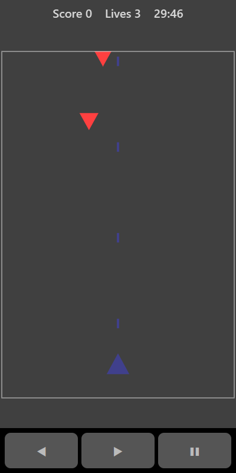

[Home](../../README.md) > [Arcade](README.md) > Space Shooter

In Space Shooter enemy ships drift down from the top of the screen, firing as they come. Your ship fires automatically. All you need to do is steer it under the enemies and out of the way of their shots.

## How to play

1. Tap **Play**. Your ship starts firing straight away.
2. Move left and right to line up with enemies.
3. Each enemy you hit is destroyed.
4. Avoid the enemies' yellow shots and don't let an enemy crash into you.
5. Getting hit costs a life and clears the enemy shots from the screen. You have 3 lives. Your ship flashes for a moment after a hit while it can't be hurt.
6. Enemies arrive more often the longer you play.

## Controls

| Action     | Touch                     | Keyboard       | Controller |
|------------|---------------------------|----------------|------------|
| Move ship  | ◀ ▶ or drag on the board  | Left and Right | D-pad      |
| Pause      | ❚❚                        | P or Escape    | Start      |

## What each eye sees

| Weaker eye                    | Stronger eye             | Both eyes      |
|-------------------------------|--------------------------|----------------|
| The enemies and their shots   | Your ship and its shots  | The board edge |

## Difficulty

| Setting | How often enemies arrive |
|---------|--------------------------|
| Easy    | Least often              |
| Normal  | Medium                   |
| Hard    | Most often               |

## Scoring

Each enemy destroyed is worth 10 points. The top bar shows your score and lives.

## Tips

* Stay near the middle so you can move either way.
* Watch the shots, not just the ships. Shots fall faster than the enemies do.
