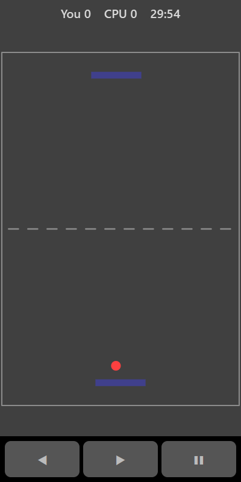

[Home](../../README.md) > [Arcade](README.md) > Table Tennis

Table Tennis is a one-on-one match against the computer. Your paddle is at the bottom and the computer's is at the top. Return the ball and try to get it past the computer. The first player to 7 points wins.

## How to play

1. Tap **Play**. After a short pause the ball is served from the middle.
2. Move your paddle under the ball to hit it back.
3. Where the ball hits your paddle sets its angle. Hit it with the edge of the paddle to send it wide.
4. The ball gets a little faster each time it is returned.
5. You score when the ball gets past the computer's paddle. The computer scores when it gets past yours.
6. The match ends when one player reaches 7.

## Controls

| Action      | Touch                     | Keyboard       | Controller |
|-------------|---------------------------|----------------|------------|
| Move paddle | ◀ ▶ or drag on the board  | Left and Right | D-pad      |
| Pause       | ❚❚                        | P or Escape    | Start      |

## What each eye sees

| Weaker eye | Stronger eye                    | Both eyes            |
|------------|---------------------------------|----------------------|
| The ball   | Your paddle and the computer's  | The net and the edge |

## Difficulty

| Setting | Computer paddle speed |
|---------|-----------------------|
| Easy    | Slow                  |
| Normal  | Medium                |
| Hard    | Fast                  |

## Scoring

The top bar shows your points and the computer's. Your best score is the most points you have won in a match.

## Tips

* The computer moves towards the ball only while it is heading its way. Angled shots make it travel further.
* After a long rally the ball is fast, so get into position early.
