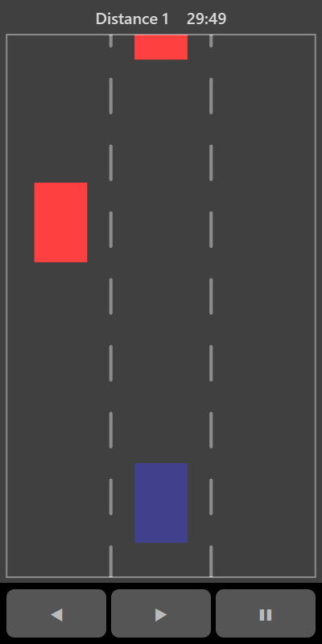

[Home](../../README.md) > [Arcade](README.md) > Traffic Racer

In Traffic Racer you drive along a three-lane road, overtaking slower cars. Switch lanes to get around them. The road gets faster the longer you last.

## How to play

1. Tap **Play**. Your car starts in the middle lane.
2. Cars appear ahead in one or two lanes at a time.
3. Move into a clear lane before you reach them.
4. The game ends if you crash into another car.

## Controls

| Action       | Touch                                          | Keyboard       | Controller |
|--------------|------------------------------------------------|----------------|------------|
| Change lane  | ◀ ▶ or tap to the left or right of your car    | Left and Right | D-pad      |
| Pause        | ❚❚                                             | P or Escape    | Start      |

## What each eye sees

| Weaker eye  | Stronger eye | Both eyes          |
|-------------|--------------|--------------------|
| The traffic | Your car     | The lane markings  |

## Difficulty

| Setting | Starting speed |
|---------|----------------|
| Easy    | Slow           |
| Normal  | Medium         |
| Hard    | Fast           |

## Scoring

Your score is the distance you drive. The top bar shows the distance so far.

## Tips

* When two lanes are blocked, move to the open lane early. Your car takes a moment to slide across.
* Look further up the road as the speed increases.
