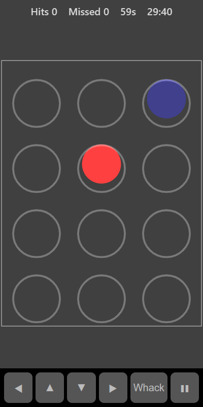

[Home](../../README.md) > [Arcade](README.md) > Whack-a-Mole

Whack-a-Mole is a one-minute reaction game. Moles pop out of holes for a moment and then hide again. Tap each one before it disappears. Spiky red bombs pop up too. Don't tap those.

## How to play

1. Tap **Play**. The round lasts 60 seconds.
2. Tap a mole while it is showing to score a hit.
3. A mole that hides before you tap it counts as a miss.
4. Tapping a bomb takes 3 points off your hits.
5. Moles appear more often as the minute goes on.

## Controls

| Action             | Touch            | Keyboard       | Controller |
|--------------------|------------------|----------------|------------|
| Whack              | Tap a hole       | Space or Enter | A          |
| Move the selection | None             | Arrow keys     | D-pad      |
| Pause              | ❚❚               | P or Escape    | Start      |

With a keyboard or controller, a white square shows which hole **Whack** will hit.

## What each eye sees

Each mole and bomb is shown to one eye only, chosen at random. About half go to your weaker eye and half to your stronger eye, so you need both to catch them all. The holes are shown to both eyes.

## Difficulty

| Setting | Holes         | How long moles stay up |
|---------|---------------|------------------------|
| Easy    | 3 × 3         | Longest                |
| Normal  | 3 × 4         | Medium                 |
| Hard    | 4 × 4         | Shortest               |

## Scoring

Your score is the number of hits, less 3 for each bomb tapped. The top bar shows hits, misses and the seconds left.

## Tips

* Keep your gaze in the middle of the board so you notice moles on every side.
* A bomb is a red spiky ball. A mole is a plain brown circle.
