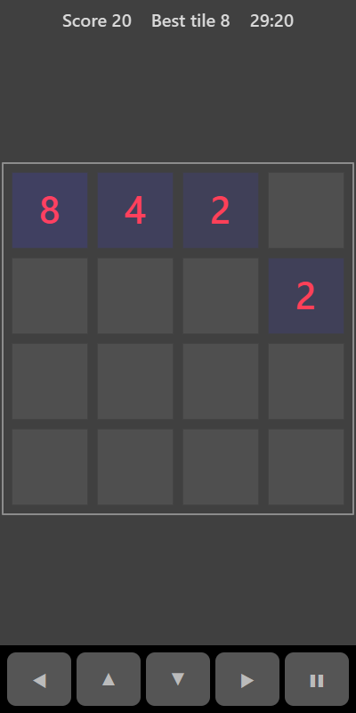

[Home](../../README.md) > [Puzzles](README.md) > 2048

2048 is played on a 4 by 4 board. Every move slides all the tiles as far as they can go in one direction. When two tiles with the same number meet they merge into one tile worth double. A new 2 or 4 appears after every move. Aim to build the 2048 tile, and beyond.

## How to play

1. Tap **Play**. The board starts with two tiles.
2. Slide the tiles up, down, left or right.
3. Matching tiles that collide merge. Two 2s make a 4, two 4s make an 8, and so on.
4. A new tile appears in an empty square after each move that changes the board.
5. The game ends when the board is full and no two neighbouring tiles match.

## Controls

| Action | Touch                          | Keyboard    | Controller |
|--------|--------------------------------|-------------|------------|
| Slide  | ◀ ▲ ▼ ▶ or swipe on the board  | Arrow keys  | D-pad      |
| Pause  | ❚❚                             | P or Escape | Start      |

## What each eye sees

| Weaker eye  | Stronger eye                               | Both eyes          |
|-------------|--------------------------------------------|--------------------|
| The numbers | The tiles (brighter for bigger numbers)    | Empty squares      |

## Difficulty

2048 is the same on every difficulty setting.

## Scoring

Each merge adds the value of the new tile to your score. The top bar shows your score and your biggest tile.

## Tips

* Keep your biggest tile in one corner and build the others towards it.
* Try to use only two or three directions most of the time so the corner tile doesn't move out.
