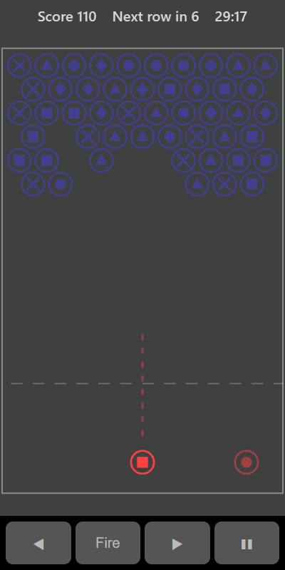

[Home](../../README.md) > [Puzzles](README.md) > Bubble Shooter

Bubble Shooter has a cluster of coloured symbol bubbles hanging from the top of the screen. Aim and fire bubbles from the bottom. When your bubble joins a group of three or more of the same symbol, they all pop. Any bubbles left hanging with nothing holding them up fall too.

## How to play

1. Tap **Play**. The bubble you will fire sits at the bottom, with the next one beside it.
2. Aim at a group of bubbles with the same symbol.
3. Fire. Bubbles can bounce off the side walls.
4. Make a group of three or more to pop it.
5. If a shot doesn't pop anything it counts towards a new row. When the count runs out, a new row of bubbles pushes down from the top.
6. Clear the board and a new set of rows appears. The game ends if a bubble reaches the dashed line near the bottom.

## Controls

| Action | Touch                                   | Keyboard            | Controller |
|--------|-----------------------------------------|---------------------|------------|
| Aim    | Drag on the board, or ◀ ▶               | Left and Right      | D-pad      |
| Fire   | Let go after dragging, or **Fire**      | Space, Enter or Up  | A          |
| Pause  | ❚❚                                      | P or Escape         | Start      |

## What each eye sees

| Weaker eye                                     | Stronger eye              | Both eyes                  |
|------------------------------------------------|---------------------------|----------------------------|
| The bubble you fire, the aim line and the next | The bubbles on the board  | The dashed line at the bottom |

To make a match you need to compare your bubble (weaker eye) with the board (stronger eye).

## Difficulty

| Setting | Kinds of bubble | Missed shots before a new row | Starting rows |
|---------|-----------------|-------------------------------|---------------|
| Easy    | 4               | 7                             | 5             |
| Normal  | 5               | 6                             | 6             |
| Hard    | 6               | 5                             | 7             |

## Scoring

| Event                           | Points |
|---------------------------------|--------|
| Each bubble popped in a group   | 10     |
| Each bubble that drops          | 20     |

The top bar shows your score and how many missed shots are left before the next row.

## Tips

* Pop bubbles near the top of a hanging group to drop everything below it.
* Bounce shots off the walls to reach bubbles that are blocked from below.
