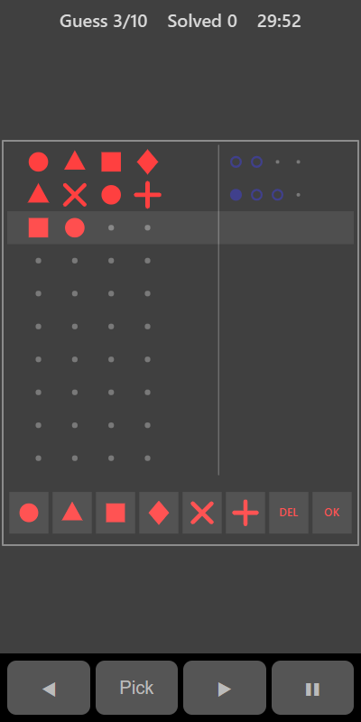

[Home](../../README.md) > [Puzzles](README.md) > Code Breaker

Code Breaker hides a short code made of shapes. Guess the code, and after each guess you get clues telling you how many shapes are right. Use the clues to crack the code within 10 guesses.

## How to play

1. Tap **Play**. The highlighted row is your current guess.
2. Tap shapes in the row at the bottom to fill your guess. Tap **DEL** to remove the last one.
3. Tap **OK** to check your guess.
4. Read the clues to the right of the guess:

   | Clue        | Meaning                                         |
   |-------------|-------------------------------------------------|
   | Solid dot   | One shape is right and in the right place       |
   | Ring        | One shape is in the code but in a different place |
   | Small dot   | Nothing more matches                            |

5. The clues don't say which shapes they belong to. That's for you to work out.
6. Crack the code to score a point. If you run out of guesses, the code is shown.
7. A new code appears after a few seconds.

## Controls

| Action              | Touch                     | Keyboard               | Controller |
|---------------------|---------------------------|------------------------|------------|
| Add a shape         | Tap the shape             | Number keys (1 is the first shape) | A |
| Remove a shape      | **DEL**                   | Backspace or Delete    | A on DEL   |
| Check the guess     | **OK**                    | Enter                  | A on OK    |
| Move the selection  | ◀ ▶                       | Left and Right         | D-pad      |
| Pause               | ❚❚                        | P or Escape            | Start      |

With a keyboard or controller, ◀ and ▶ move a white square along the bottom row and **Pick** presses whatever it is on.

## What each eye sees

| Weaker eye                               | Stronger eye                    | Both eyes                     |
|------------------------------------------|---------------------------------|-------------------------------|
| The shapes in your guesses and the row of shapes | The clue dots and rings | Empty places and button outlines |

You need both eyes to link each guess to its clues.

## Difficulty

| Setting | Code length | Shapes to choose from | Repeated shapes in the code |
|---------|-------------|-----------------------|-----------------------------|
| Easy    | 3           | 5                     | No                          |
| Normal  | 4           | 6                     | No                          |
| Hard    | 5           | 7                     | Yes                         |

## Scoring

The top bar shows your guess number (or a message) and how many codes you have cracked.

## Tips

* Start with different shapes in every place so you learn which shapes are in the code.
* Once you know which shapes are in the code, move them one at a time to find their places.
