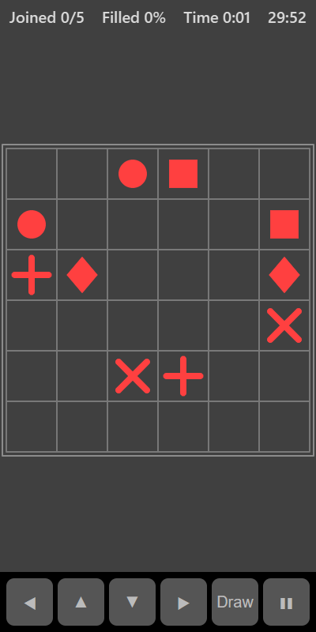

[Home](../../README.md) > [Puzzles](README.md) > Flowgrid

Flowgrid is a grid with pairs of matching shapes dotted around it. Draw a path between each pair. Paths can't cross or branch, and to win every square on the grid must be covered by a path. Every puzzle has at least one solution.

## How to play

1. Tap **Play**. The timer starts.
2. Put your finger on a shape and drag to draw a path, one square at a time, up, down, left or right.
3. Finish on the matching shape to join the pair. A joined path turns brighter.
4. Drag back along a path to shorten it. Start dragging from the middle of a path to carry on from there.
5. Starting from a shape again clears its path so you can redraw it.
6. Drawing through another path cuts that path short.
7. You win when every pair is joined and every square is filled.

## Controls

| Action                      | Touch                               | Keyboard        | Controller |
|-----------------------------|-------------------------------------|-----------------|------------|
| Draw a path                 | Drag from a shape or a path         | Arrow keys while drawing | D-pad while drawing |
| Start or stop drawing       | Put your finger down or lift it     | Space or Enter  | A          |
| Move the selection          | None                                | Arrow keys      | D-pad      |
| Pause                       | ❚❚                                  | P or Escape     | Start      |

With a keyboard or controller, move the white square to a shape and press **Draw**. The square gets thicker to show you are drawing. Use the arrows to extend the path and press **Draw** again to stop.

## What each eye sees

| Weaker eye | Stronger eye        | Both eyes      |
|------------|---------------------|----------------|
| The shapes | The paths you draw  | The grid lines |

To join a pair, you have to follow your path (stronger eye) to the matching shape (weaker eye).

## Difficulty

| Setting | Grid    | Pairs |
|---------|---------|-------|
| Easy    | 5 × 5   | 4     |
| Normal  | 6 × 6   | 5     |
| Hard    | 7 × 7   | 6     |

## Scoring

Your time is your score. The top bar shows how many pairs are joined, how much of the grid is filled and the time. Your best is your fastest solve.

## Tips

* Start with shapes near the edges and corners. Their paths usually have fewer choices.
* If all the pairs are joined but some squares are empty, one of the paths needs to take a longer route through the gap.
