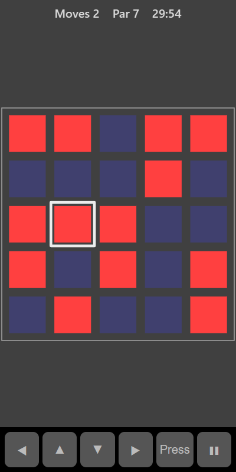

[Home](../../README.md) > [Puzzles](README.md) > Lights Out

Lights Out is a grid of lights, some on and some off. Pressing a square flips it and its four neighbours (above, below, left and right): on lights go off and off lights come on. Switch every light off.

## How to play

1. Tap **Play**.
2. Press a square. It and its neighbours flip.
3. Keep pressing until every light is off.
4. The top bar shows **Par**, the number of presses used to mix up the board. You can always solve it in that many presses, and sometimes fewer.

## Controls

| Action             | Touch          | Keyboard       | Controller |
|--------------------|----------------|----------------|------------|
| Press a square     | Tap it         | Space or Enter | A          |
| Move the selection | ◀ ▲ ▼ ▶        | Arrow keys     | D-pad      |
| Pause              | ❚❚             | P or Escape    | Start      |

## What each eye sees

| Weaker eye               | Stronger eye              | Both eyes     |
|--------------------------|---------------------------|---------------|
| The lights that are on   | The lights that are off   | The selection |

You need both eyes to see the whole board.

## Difficulty

| Setting | Grid    | Par |
|---------|---------|-----|
| Easy    | 4 × 4   | 4   |
| Normal  | 5 × 5   | 7   |
| Hard    | 6 × 6   | 10  |

## Scoring

Each press counts as one move. Your best is the lowest number of moves you have needed.

## Tips

* Pressing the same square twice undoes it, so you never need to press any square more than once.
* Try chasing the lights down: switch off every light in a row by pressing the square directly below each one, then move on to the next row. If lights are left in the bottom row, press a few squares in the top row and chase them down again.
