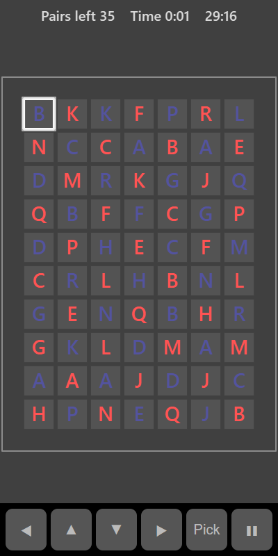

[Home](../../README.md) > [Puzzles](README.md) > Link Pairs

Link Pairs fills a board with symbol tiles. Each symbol appears an even number of times. Remove two matching tiles by selecting them, but only if they can be joined by a path of up to three straight lines (two turns) that doesn't pass through any other tile. The path can go around the outside of the board. Clear every tile to win.

## How to play

1. Tap **Play**. The timer starts.
2. Tap a tile to select it.
3. Tap a matching tile. If a path links them, both are removed and the path flashes briefly.
4. If they can't be linked, the second tile becomes the selected one instead.
5. If no pairs can be linked, the remaining tiles are shuffled for you.
6. Clear the board to finish.

## Controls

| Action             | Touch        | Keyboard       | Controller |
|--------------------|--------------|----------------|------------|
| Select a tile      | Tap the tile | Space or Enter | A          |
| Move the selection | ◀ ▲ ▼ ▶      | Arrow keys     | D-pad      |
| Pause              | ❚❚           | P or Escape    | Start      |

## What each eye sees

Symbols on alternate squares are shown to alternate eyes, like a chessboard. Half are seen by your weaker eye and half by your stronger eye, so you need both to find a pair. The tile backgrounds, selection and path are shown to both eyes.

## Difficulty

| Setting | Board    | Different symbols |
|---------|----------|-------------------|
| Easy    | 6 × 8    | 12                |
| Normal  | 7 × 10   | 16                |
| Hard    | 8 × 11   | 20                |

## Scoring

Your time is your score. The top bar shows the pairs left and the time. Your best is your fastest clear.

## Tips

* Start with tiles around the edges. They are easiest to link because paths can run around the outside.
* Removing a pair opens new paths, so look again around the gap you just made.
