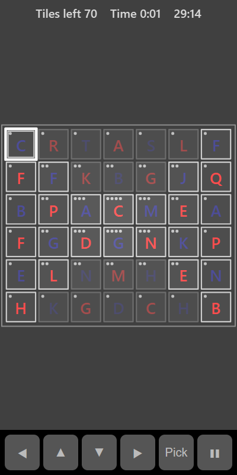

[Home](../../README.md) > [Puzzles](README.md) > Mahjong Solitaire

Mahjong Solitaire lays out tiles in stacks. Remove them in matching pairs until the board is clear. You can only take a tile when it is free: nothing is on top of it, and either its left or right side is open.

## How to play

1. Tap **Play**. The timer starts.
2. Find two free tiles with the same symbol. Free tiles have a bright outline; blocked tiles are dimmer.
3. Tap one, then the other. Both are removed.
4. Removing tiles uncovers the ones below and frees their neighbours.
5. The small dots in the corner of each tile show how many tiles are in that stack.
6. If you run out of free pairs, the remaining tiles are shuffled for you. Every deal can be solved.
7. Clear the board to finish.

## Controls

| Action             | Touch        | Keyboard       | Controller |
|--------------------|--------------|----------------|------------|
| Select a tile      | Tap the tile | Space or Enter | A          |
| Move the selection | ◀ ▲ ▼ ▶      | Arrow keys     | D-pad      |
| Pause              | ❚❚           | P or Escape    | Start      |

Tap a selected tile again to deselect it. Tapping a different free tile that doesn't match selects that one instead.

## What each eye sees

Tile symbols alternate between your eyes like a chessboard. Half are shown to your weaker eye and half to your stronger eye. The tile outlines and stack dots are shown to both eyes.

## Difficulty

| Setting | Tiles | Different symbols |
|---------|-------|-------------------|
| Easy    | 36    | 12                |
| Normal  | 70    | 18                |
| Hard    | 84    | 21                |

## Scoring

Your time is your score. The top bar shows the tiles left and the time. Your best is your fastest clear.

## Tips

* Work on the tallest stacks first. They hide the most tiles.
* If three or four of the same symbol are free, think about which pair opens up the most new tiles.
