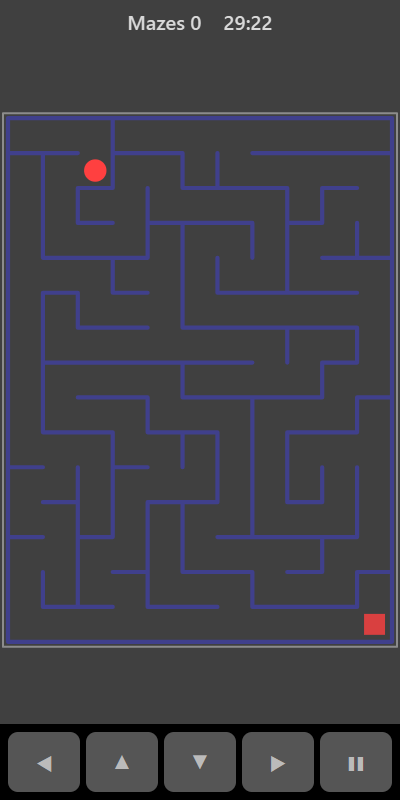

[Home](../../README.md) > [Puzzles](README.md) > Maze

Maze gives you a new randomly built maze each time. You start in the top-left corner as a yellow dot. The exit is the green square in the bottom-right corner. Every maze has exactly one route between any two points, so there is always a way through.

## How to play

1. Tap **Play**.
2. Move one square at a time. You can't move through walls.
3. Reach the green exit square to complete the maze.
4. A fresh maze appears straight away. Keep going for as long as you like.

## Controls

| Action | Touch                          | Keyboard    | Controller |
|--------|--------------------------------|-------------|------------|
| Move   | ◀ ▲ ▼ ▶ or swipe on the board  | Arrow keys  | D-pad      |
| Pause  | ❚❚                             | P or Escape | Start      |

Holding a direction button keeps moving.

## What each eye sees

| Weaker eye        | Stronger eye | Both eyes      |
|-------------------|--------------|----------------|
| You and the exit  | The walls    | The board edge |

You need the walls from one eye and your position from the other to find your way.

## Difficulty

| Setting | Maze size  |
|---------|------------|
| Easy    | 8 × 11     |
| Normal  | 11 × 15    |
| Hard    | 14 × 20    |

## Scoring

The top bar counts how many mazes you have completed.

## Tips

* Trace the route from the exit backwards with your eyes before you move.
* If you hit a dead end, go back to the last junction and try the other way.
