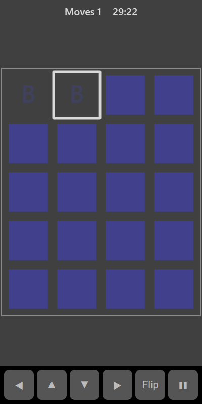

[Home](../../README.md) > [Puzzles](README.md) > Memory Match

Memory Match lays out a grid of face-down cards. Each letter appears on exactly two cards. Turn over two cards at a time. If they match they stay face up. If not, they turn back over and you have to remember where they were.

## How to play

1. Tap **Play**.
2. Tap a card to turn it over, then tap a second card.
3. If the letters match, the pair stays face up and fades.
4. If they don't match, both cards turn back over after a moment. You can also tap another card straight away to hide them sooner.
5. Find every pair to finish.

## Controls

| Action             | Touch        | Keyboard       | Controller |
|--------------------|--------------|----------------|------------|
| Turn over a card   | Tap the card | Space or Enter | A          |
| Move the selection | ◀ ▲ ▼ ▶      | Arrow keys     | D-pad      |
| Pause              | ❚❚           | P or Escape    | Start      |

## What each eye sees

| Weaker eye                       | Stronger eye                   | Both eyes                 |
|----------------------------------|--------------------------------|---------------------------|
| The letters on turned-over cards | The face-down cards and matched letters | The outline of turned-over cards |

## Difficulty

| Setting | Cards           | Pairs |
|---------|-----------------|-------|
| Easy    | 4 × 4           | 8     |
| Normal  | 4 × 5           | 10    |
| Hard    | 5 × 6           | 15    |

## Scoring

Each pair of cards you turn over counts as one move. Fewer moves is better. Your best is the lowest number of moves you have needed.

## Tips

* Work through the grid in order at the start so it's easier to remember where each letter was.
* Say the letters to yourself as you see them.
