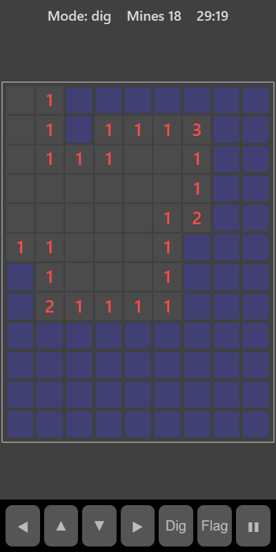

[Home](../../README.md) > [Puzzles](README.md) > Mine Sweeper

Mine Sweeper hides mines under a grid of covered squares. Dig a square to uncover it. If it has no mine, it shows a number telling you how many of the eight squares around it hold mines. Use the numbers to work out where the mines are, and uncover every safe square.

## How to play

1. Tap **Play**.
2. Tap any square to dig. Your first dig is always safe and opens up an area.
3. Each number shows how many mines touch that square, including diagonally. A blank square has none, and its neighbours open automatically.
4. When you're sure a square has a mine, switch to flag mode and tap it to mark it. Flagged squares can't be dug by accident.
5. Dig every square that doesn't have a mine to win. Digging a mine ends the game.

## Controls

| Action                    | Touch           | Keyboard       | Controller |
|---------------------------|-----------------|----------------|------------|
| Dig (or flag in flag mode)| Tap a square    | Space or Enter | A          |
| Switch dig or flag mode   | **Flag**        | X              | B          |
| Move the selection        | ◀ ▲ ▼ ▶         | Arrow keys     | D-pad      |
| Pause                     | ❚❚              | P or Escape    | Start      |

The top bar shows whether you are in dig or flag mode. Tap a flagged square in flag mode to remove the flag.

## What each eye sees

| Weaker eye                              | Stronger eye         | Both eyes              |
|-----------------------------------------|----------------------|------------------------|
| The number clues, flags and any mines   | The covered squares  | The uncovered squares  |

## Difficulty

| Setting | Grid     | Mines |
|---------|----------|-------|
| Easy    | 8 × 10   | 10    |
| Normal  | 9 × 12   | 18    |
| Hard    | 10 × 14  | 28    |

## Scoring

The timer starts with your first dig. Your best is your fastest clear. The top bar shows the mode and how many mines are left unflagged.

## Tips

* A 1 next to only one covered square means that square is a mine.
* Once a number has all its mines flagged, every other covered square around it is safe.
