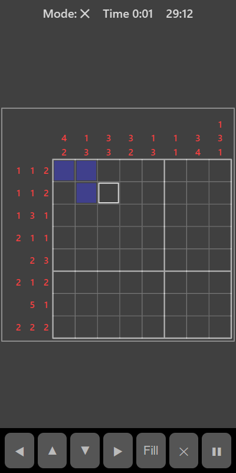

[Home](../../README.md) > [Puzzles](README.md) > Picture Logic

Picture Logic (also known as a nonogram) is a grid with numbers along the top and left. Each number is a run of filled squares in that row or column, in the order shown. Runs are separated by at least one empty square. Work out which squares to fill to reveal the hidden pattern. The pattern is different every time.

## How to play

1. Tap **Play**. The timer starts.
2. Read the clues. For example, `3 1` means a run of three filled squares, then at least one gap, then one filled square.
3. Tap a square to fill it. Tap again to clear it. You can drag to fill several squares at once.
4. Switch to ✕ mode to mark squares you know must stay empty. This is optional but helps you keep track.
5. Clues fade once their row or column is correct.
6. The puzzle is solved when every row and column matches its clues.

## Controls

| Action                    | Touch                     | Keyboard       | Controller |
|---------------------------|---------------------------|----------------|------------|
| Fill or mark a square     | Tap or drag on the grid   | Space or Enter | A          |
| Switch fill or ✕ mode     | **✕**                     | X              | B          |
| Move the selection        | ◀ ▲ ▼ ▶                   | Arrow keys     | D-pad      |
| Pause                     | ❚❚                        | P or Escape    | Start      |

The top bar shows whether you are in fill or ✕ mode.

## What each eye sees

| Weaker eye        | Stronger eye                        | Both eyes      |
|-------------------|-------------------------------------|----------------|
| The number clues  | The grid and the squares you fill   | The board edge |

## Difficulty

| Setting | Grid     |
|---------|----------|
| Easy    | 5 × 5    |
| Normal  | 8 × 8    |
| Hard    | 10 × 10  |

## Scoring

Your time is your score. Your best is your fastest solve.

## Tips

* Start with big numbers. A run of 7 in a row of 8 must cover the middle six squares whichever way it sits.
* A clue of 0 means the whole row or column is empty. Once a row or column is complete, its other squares are empty too. Mark them with ✕.
