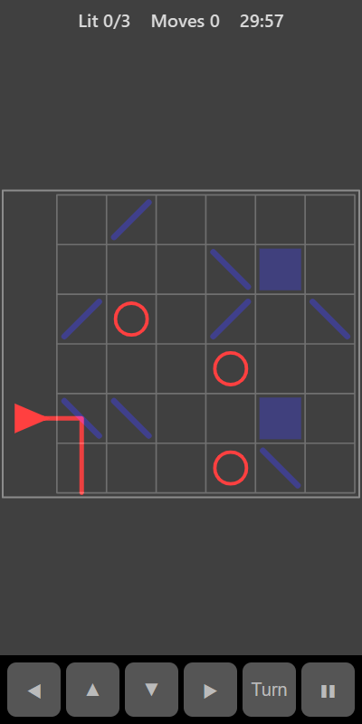

[Home](../../README.md) > [Puzzles](README.md) > Prism

Prism is a light-beam puzzle. A light on the left shines a beam into a grid of mirrors. Each mirror sits at one of two angles and bounces the beam through a right angle. Turn the mirrors so the beam passes through every target ring.

## How to play

1. Tap **Play**.
2. Follow the beam from the light. It travels in a straight line until it hits a mirror, where it turns.
3. Tap a mirror to flip it to the other angle. The beam changes straight away.
4. Walls (solid blocks) stop the beam.
5. A target fills in when the beam passes through it.
6. You win when every target is lit at the same time.

## Controls

| Action             | Touch            | Keyboard       | Controller |
|--------------------|------------------|----------------|------------|
| Turn a mirror      | Tap the mirror   | Space or Enter | A          |
| Move the selection | ◀ ▲ ▼ ▶          | Arrow keys     | D-pad      |
| Pause              | ❚❚               | P or Escape    | Start      |

## What each eye sees

| Weaker eye                         | Stronger eye           | Both eyes      |
|------------------------------------|------------------------|----------------|
| The light, the beam and the targets | The mirrors and walls  | The grid lines |

To steer the beam you need to see where it goes (weaker eye) and which way the mirrors face (stronger eye).

## Difficulty

| Setting | Grid    | Mirrors | Targets | Walls |
|---------|---------|---------|---------|-------|
| Easy    | 5 × 5   | 5       | 2       | 0     |
| Normal  | 6 × 6   | 8       | 3       | 2     |
| Hard    | 7 × 7   | 11      | 4       | 3     |

Every puzzle has a solution.

## Scoring

Each mirror turn counts as one move. Your best is the lowest number of moves you have needed. The top bar shows how many targets are lit and your moves.

## Tips

* Work from the light outwards. Get the beam to the first target, then think about the next.
* Not every mirror needs to be used. Some are only there to get in the way.
