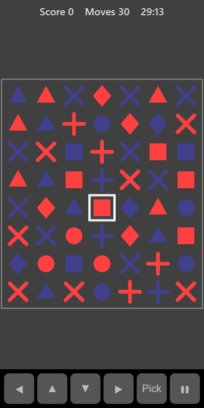

[Home](../../README.md) > [Puzzles](README.md) > Shape Crush

Shape Crush is a match-three game on a 7 by 8 board of coloured shapes. Swap two neighbouring shapes to make a line of three or more the same. The line clears, the shapes above fall down and new ones drop in from the top. Falling shapes can make new lines for bonus chains. You have 30 moves to score as much as you can.

## How to play

1. Tap **Play**.
2. Swap two shapes that are side by side or one above the other.
3. A swap only counts if it makes a line of three or more. Otherwise the shapes swap back and you don't lose a move.
4. Matched shapes flash and clear. Shapes above fall and new ones fill the gaps.
5. If the new shapes make more lines, they clear too as a chain.
6. The game ends when you run out of moves.

## Controls

| Action                    | Touch                                           | Keyboard                                   | Controller            |
|---------------------------|-------------------------------------------------|--------------------------------------------|-----------------------|
| Swap                      | Swipe a shape towards its neighbour, or tap one shape then the other | Space or Enter to select, then an arrow | A, then D-pad |
| Move the selection        | ◀ ▲ ▼ ▶                                         | Arrow keys                                 | D-pad                 |
| Pause                     | ❚❚                                              | P or Escape                                | Start                 |

## What each eye sees

Shapes on alternate squares are shown to alternate eyes, like a chessboard. To spot a line of three you need to put together shapes from both eyes.

## Difficulty

| Setting | Kinds of shape |
|---------|----------------|
| Easy    | 5              |
| Normal  | 6              |
| Hard    | 7              |

Fewer kinds of shape make lines easier to find.

## Scoring

Each cleared shape scores 10 points, multiplied by the step in the chain. The first clear after a swap scores × 1, the next × 2, and so on. The top bar shows your score and moves left.

## Tips

* Make matches near the bottom of the board. More shapes fall afterwards, so chains are more likely.
* Look for two of a kind with a gap, then find the third shape nearby to swap in.
