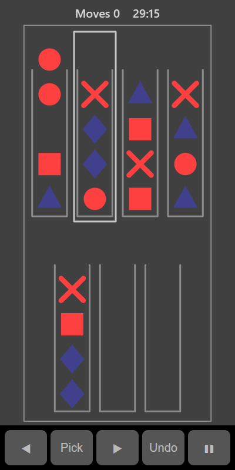

[Home](../../README.md) > [Puzzles](README.md) > Shape Sort

Shape Sort gives you a row of tubes, each holding up to four shapes, plus two empty tubes. The shapes start mixed up. Move them from tube to tube until every full tube holds four of the same shape.

## How to play

1. Tap **Play**.
2. Tap a tube to pick up its top shape. If several matching shapes are on top, they lift together.
3. Tap another tube to drop them there. You can only drop onto the same shape or into an empty tube, and only if there's room.
4. Tap the same tube again to put the shapes back down. If the tube you tap can't take them, that tube is picked up instead.
5. Keep going until every tube is either empty or full of one kind of shape.

## Controls

| Action              | Touch      | Keyboard       | Controller |
|---------------------|------------|----------------|------------|
| Pick up or drop     | Tap a tube | Space or Enter | A          |
| Move the selection  | ◀ ▶        | Left and Right | D-pad      |
| Undo the last move  | **Undo**   | X              | B          |
| Pause               | ❚❚         | P or Escape    | Start      |

You can undo as many moves as you like.

## What each eye sees

Half of the kinds of shape are shown to your weaker eye and the other half to your stronger eye. The tubes are shown to both eyes.

## Difficulty

| Setting | Kinds of shape | Tubes in total |
|---------|----------------|----------------|
| Easy    | 4              | 6              |
| Normal  | 5              | 7              |
| Hard    | 7              | 9              |

## Scoring

Each drop counts as one move. Your best is the lowest number of moves you have needed.

## Tips

* Keep one tube empty for as long as you can. It gives you room to shuffle shapes around.
* Use **Undo** freely if you get stuck.
