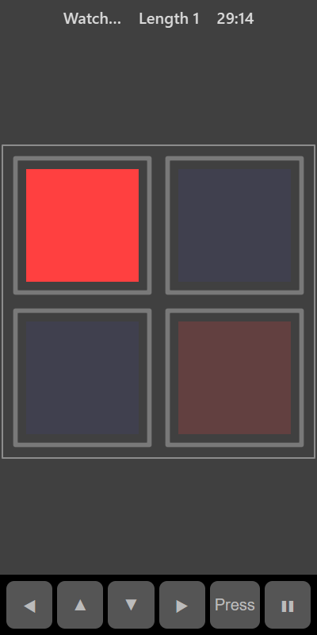

[Home](../../README.md) > [Puzzles](README.md) > Simon

Simon is a memory game. Coloured panels light up one after another. When the sequence finishes, press the panels in the same order. Each round adds one more step to the end of the sequence. See how long a sequence you can remember.

## How to play

1. Tap **Play**. The top bar shows **Watch…** while the sequence plays.
2. Watch the panels light up.
3. When the top bar says **Your turn**, press the panels in the same order.
4. Get it right and the sequence plays again with one extra step.
5. A wrong press ends the game.

## Controls

| Action             | Touch         | Keyboard       | Controller |
|--------------------|---------------|----------------|------------|
| Press a panel      | Tap the panel | Space or Enter | A          |
| Move the selection | ◀ ▲ ▼ ▶       | Arrow keys     | D-pad      |
| Pause              | ❚❚            | P or Escape    | Start      |

## What each eye sees

The panels alternate between your eyes like a chessboard. Half are shown to your weaker eye and half to your stronger eye, so you have to watch with both. The panel frames are shown to both eyes.

## Difficulty

| Setting | Panels | Speed of the sequence |
|---------|--------|-----------------------|
| Easy    | 4      | Slow                  |
| Normal  | 4      | Medium                |
| Hard    | 6      | Fast                  |

## Scoring

Your score is the length of the longest sequence you repeated correctly. The top bar shows the current length.

## Tips

* Name the colours to yourself as they light up.
* Group the sequence into chunks of three or four steps.
