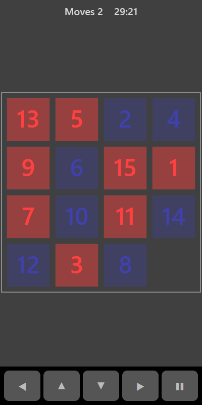

[Home](../../README.md) > [Puzzles](README.md) > Sliding Puzzle

Sliding Puzzle is a square tray of numbered tiles with one gap. The tiles start mixed up. Slide them, one row or column at a time, until they read in order from the top-left with the gap in the bottom-right corner.

## How to play

1. Tap **Play**.
2. Tap any tile in the same row or column as the gap. That tile, and any between it and the gap, slide over.
3. Keep sliding until the numbers run 1, 2, 3 and so on across each row, with the gap last.

## Controls

| Action      | Touch                                         | Keyboard    | Controller |
|-------------|-----------------------------------------------|-------------|------------|
| Slide       | Tap a tile in line with the gap, or swipe     | Arrow keys  | D-pad      |
| Pause       | ❚❚                                            | P or Escape | Start      |

An arrow moves the tile next to the gap in that direction. For example, Left slides the tile on the right of the gap to the left.

## What each eye sees

| Weaker eye          | Stronger eye         | Both eyes      |
|---------------------|----------------------|----------------|
| Odd-numbered tiles  | Even-numbered tiles  | The board edge |

## Difficulty

| Setting | Tray size | Tiles |
|---------|-----------|-------|
| Easy    | 3 × 3     | 8     |
| Normal  | 4 × 4     | 15    |
| Hard    | 5 × 5     | 24    |

## Scoring

Each slide counts as one move. Your best is the lowest number of moves you have needed.

## Tips

* Solve the top row first, then the left column. You are left with a smaller puzzle each time.
* Put the last two tiles of a row in place together by lining them up below their spots first.
