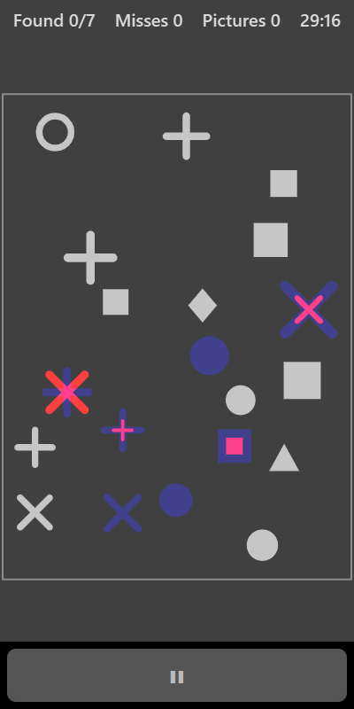

[Home](../../README.md) > [Puzzles](README.md) > Spot the Difference

Spot the Difference is a different kind of spot-the-difference. Instead of two pictures side by side, each eye is shown its own version of one picture. Most shapes are the same for both eyes. A few are different, and with your glasses on they seem to shimmer, flicker or look odd. Tap each one you find.

## How to play

1. Tap **Play**. A picture of scattered shapes appears.
2. Look for shapes that seem to shimmer, flicker, or look like two shapes at once.
3. Tap each difference you spot. A ring appears around it and it settles down to look the same for both eyes.
4. Tapping somewhere that isn't a difference shows a small cross and counts as a miss.
5. Find them all and a new picture appears.

## Kinds of difference

| Kind              | What you see                                      |
|-------------------|---------------------------------------------------|
| Weaker eye only   | A shape only your weaker eye can see              |
| Stronger eye only | A shape only your stronger eye can see            |
| Swapped shape     | Each eye sees a different shape in the same place |
| Different size    | Each eye sees the same shape at a different size  |

## Controls

| Action           | Touch          | Keyboard    | Controller |
|------------------|----------------|-------------|------------|
| Mark a difference| Tap the shape  | None        | None       |
| Pause            | ❚❚             | P or Escape | Start      |

Spot the Difference needs touch, so it can't be played in split-screen mode with a controller.

## What each eye sees

Shapes that are the same are shown to both eyes. Each difference is shown differently to each eye, as listed above. This game works best when the two eyes are combining well, so it's a good test of how your glasses and contrast are set up.

## Difficulty

| Setting | Shapes in the picture | Differences |
|---------|-----------------------|-------------|
| Easy    | 16                    | 5           |
| Normal  | 20                    | 7           |
| Hard    | 24                    | 9           |

## Scoring

The top bar shows how many differences you have found, your misses and how many pictures you have finished.

## Tips

* Try closing one eye, then the other. A shape that appears or changes is a difference.
* If nothing seems to shimmer, try raising the stronger-eye contrast a little in Settings.
