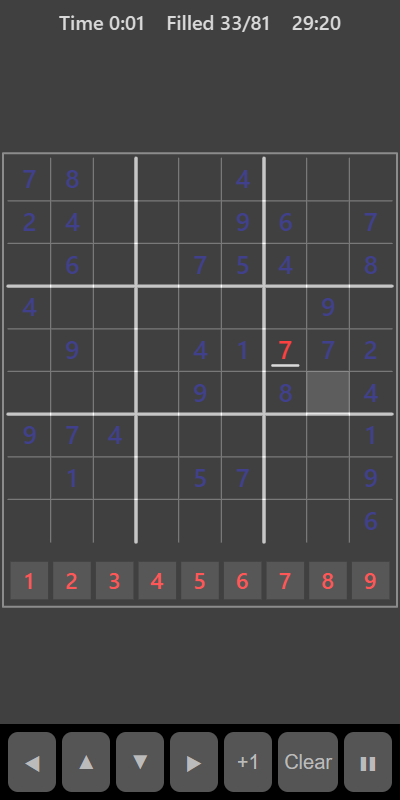

[Home](../../README.md) > [Puzzles](README.md) > Sudoku

Sudoku is a 9 by 9 grid divided into nine 3 by 3 boxes. Some numbers are already filled in. Fill every empty square so that each row, each column and each box contains the numbers 1 to 9 exactly once.

## How to play

1. Tap **Play**. The timer starts.
2. Tap an empty square to select it. It is shaded.
3. Tap a number in the row below the grid to put it in the square. Tap the same number again to clear it.
4. A number that clashes with another in the same row, column or box is underlined.
5. The puzzle is solved when every square is filled with no clashes.

## Controls

| Action                  | Touch                        | Keyboard                   | Controller |
|-------------------------|------------------------------|----------------------------|------------|
| Select a square         | Tap it                       | Arrow keys                 | D-pad      |
| Enter a number          | Tap a number below the grid  | 1 to 9                     | None       |
| Step the number up by 1 | **+1**                       | Space or Enter             | A          |
| Clear the square        | **Clear**                    | X, Backspace, Delete or 0  | B          |
| Pause                   | ❚❚                           | P or Escape                | Start      |

With a controller, press **+1** repeatedly to step through the numbers.

## What each eye sees

| Weaker eye                                | Stronger eye        | Both eyes                         |
|-------------------------------------------|---------------------|-----------------------------------|
| The numbers you enter and the number row  | The given numbers   | Grid lines and the selected square |

You need both eyes to check a row or box, because the given numbers and your own numbers are split between them.

## Difficulty

| Setting | Numbers given at the start |
|---------|----------------------------|
| Easy    | 40                         |
| Normal  | 32                         |
| Hard    | 27                         |

## Scoring

Your time is your score. The top bar shows the time and how many squares are filled. Your best is your fastest solve.

## Tips

* Look for rows, columns or boxes that are nearly full first.
* For each empty square, rule out the numbers already in its row, column and box. If only one is left, that's the answer.
