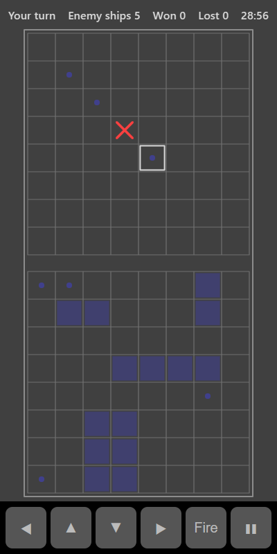

[Home](../../README.md) > [Strategy](README.md) > Battleships

Battleships is a guessing game. You and the computer each have a fleet of five ships hidden on an 8 by 8 grid. Take turns firing at squares on each other's grid. The first to sink the whole enemy fleet wins.

## Layout

| Grid    | What it shows                                                   |
|---------|-----------------------------------------------------------------|
| Top     | The computer's waters. Fire here. Your hits and misses are marked |
| Bottom  | Your own fleet, with the computer's hits and misses on it       |

## How to play

1. Tap **Play**. Both fleets are placed for you at random.
2. On your turn, tap a square on the top grid to fire at it.
3. A cross means you hit a ship. A dot means you missed.
4. When every square of a ship has been hit, it sinks and an outline appears round it.
5. The computer then fires at your fleet on the bottom grid.
6. Sink all five enemy ships to win the round.

## Fleet

| Ship length | Number |
|-------------|--------|
| 4           | 1      |
| 3           | 2      |
| 2           | 2      |

## Controls

| Action             | Touch                    | Keyboard       | Controller |
|--------------------|--------------------------|----------------|------------|
| Fire               | Tap a square on the top grid | Space or Enter | A      |
| Move the selection | ◀ ▲ ▼ ▶                  | Arrow keys     | D-pad      |
| Pause              | ❚❚                       | P or Escape    | Start      |

## What each eye sees

| Weaker eye  | Stronger eye                 | Both eyes                    |
|-------------|------------------------------|------------------------------|
| Hits        | Misses and your own ships    | The grids and sunk-ship outlines |

## Difficulty

| Setting | How the computer fires                                                   |
|---------|--------------------------------------------------------------------------|
| Easy    | At random                                                                |
| Normal  | At random until it gets a hit, then at the squares around it             |
| Hard    | Like Normal, but searches in a chequerboard pattern to find ships faster |

## Scoring

The top bar shows whose turn it is, how many enemy ships are left, and your wins and losses.

## Tips

* After a hit, try the four squares around it to find which way the ship lies.
* The smallest ship is two squares long, so firing at every other square covers the grid in half the shots.
