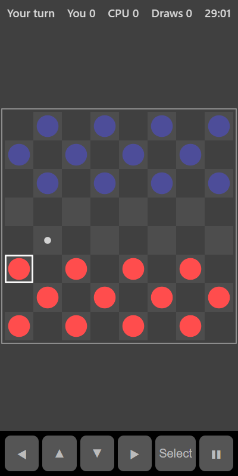

[Home](../../README.md) > [Strategy](README.md) > Checkers

Checkers (also called draughts) is played on the dark squares of an 8 by 8 board. Your pieces start at the bottom and the computer's at the top. Pieces move diagonally forwards. Jump over an opponent's piece to capture it. Win by capturing all the computer's pieces or leaving it with no moves.

## How to play

1. Tap **Play**.
2. Tap one of your pieces. Dots show where it can move.
3. Tap a dotted square to move there.
4. A normal move is one square diagonally forwards.
5. If a computer piece is diagonally next to yours with an empty square behind it, you can jump over it to capture it. Jumps are compulsory: if you can jump, you must.
6. After a jump, if the same piece can jump again, it must keep going.
7. A piece that reaches the far side becomes a king, shown with a ring. Kings move and jump both forwards and backwards.
8. You win the round if the computer has no pieces or no moves left. After 80 moves in a row without a capture, the round is a draw.

## Controls

| Action                     | Touch          | Keyboard       | Controller |
|----------------------------|----------------|----------------|------------|
| Select a piece or square   | Tap it         | Space or Enter | A          |
| Move the selection         | ◀ ▲ ▼ ▶        | Arrow keys     | D-pad      |
| Pause                      | ❚❚             | P or Escape    | Start      |

## What each eye sees

| Weaker eye   | Stronger eye           | Both eyes                  |
|--------------|------------------------|----------------------------|
| Your pieces  | The computer's pieces  | The board and move dots    |

## Difficulty

| Setting | How far ahead the computer looks | Random moves  |
|---------|----------------------------------|---------------|
| Easy    | 1 move                           | Half the time |
| Normal  | 3 moves                          | None          |
| Hard    | 5 moves                          | None          |

## Scoring

The top bar shows whose turn it is and your wins, losses and draws.

## Tips

* Keep your back row filled for as long as you can. It stops the computer making kings.
* Move pieces in pairs so a lone piece can't be jumped.
* Use forced jumps to lure the computer's pieces into a place where you can jump back.
