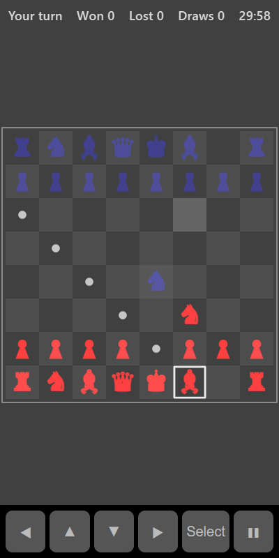

[Home](../../README.md) > [Strategy](README.md) > Chess

Chess is played on an 8 by 8 board. Your pieces start along the bottom and the computer's along the top. Take turns moving one piece at a time. Win by checkmating the computer's king: attacking it so that it has no way to escape.

## How to play

1. Tap **Play**. Who moves first swaps each round. The player who moves first plays the role of white.
2. Tap one of your pieces. Dots show the squares it can move to, and rings show pieces it can capture.
3. Tap a marked square to make the move. Tap the piece again, or another of your pieces, to change your mind.
4. The last move made is shaded so you can see what the computer did.
5. When a king is in check, a red ring appears round it and the top bar says **Check!**. Only moves that get out of check are allowed.
6. The round ends with checkmate, or with a draw. A new round then starts automatically.

## How the pieces move

| Piece  | Moves                                                                                   |
|--------|-----------------------------------------------------------------------------------------|
| King   | One square in any direction                                                             |
| Queen  | Any distance in a straight line or diagonal                                             |
| Rook   | Any distance up, down, left or right                                                    |
| Bishop | Any distance diagonally                                                                 |
| Knight | In an L shape (two squares one way and one to the side), jumping over anything in the way |
| Pawn   | One square forward, or two from its starting square. Captures one square diagonally forward |

## Special moves

| Move        | How it works                                                                                                      |
|-------------|-------------------------------------------------------------------------------------------------------------------|
| Castling    | Move the king two squares towards a rook and the rook jumps over it. Only allowed if neither has moved, the squares between are empty, and the king isn't in, through or into check. Tap the king, then the square two to the side |
| En passant  | If a pawn moves two squares and lands beside one of your pawns, you can capture it on your next move as if it had moved one square |
| Promotion   | A pawn that reaches the far side becomes a queen                                                                  |

## How a round ends

| Result               | When                                                                    |
|----------------------|-------------------------------------------------------------------------|
| Win or loss          | Checkmate                                                               |
| Draw: Stalemate      | The player to move isn't in check but has no legal move                 |
| Draw: Repetition     | The same position comes up three times                                  |
| Draw: 50-move rule   | 50 moves each without a capture or a pawn move                          |
| Draw: Not enough pieces | Only kings are left, or a king with a single bishop or knight        |

## Controls

| Action                   | Touch          | Keyboard       | Controller |
|--------------------------|----------------|----------------|------------|
| Select a piece or square | Tap it         | Space or Enter | A          |
| Move the selection       | ◀ ▲ ▼ ▶        | Arrow keys     | D-pad      |
| Pause                    | ❚❚             | P or Escape    | Start      |

## What each eye sees

| Weaker eye   | Stronger eye           | Both eyes                                   |
|--------------|------------------------|---------------------------------------------|
| Your pieces  | The computer's pieces  | The board, move dots, last move and check ring |

To spot threats and captures you have to look at both armies at once.

## Difficulty

| Setting | How the computer plays                                       |
|---------|--------------------------------------------------------------|
| Easy    | Looks 1 move ahead, and plays a random move about a third of the time |
| Normal  | Looks 2 moves ahead                                          |
| Hard    | Looks 3 moves ahead                                          |

At every level the computer also follows any series of captures to the end before deciding, so it rarely leaves pieces where they can be taken for free.

## Scoring

The top bar shows whose turn it is (or the result), and your wins, losses and draws.

## Tips

* Control the centre early with pawns and knights.
* Castle early to keep your king safe.
* Before every move, check whether any of your pieces can be captured, and whether the computer has just threatened something.
