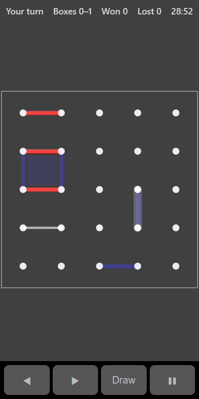

[Home](../../README.md) > [Strategy](README.md) > Dots and Boxes

Dots and Boxes starts with a grid of dots. You and the computer take turns drawing a line between two neighbouring dots. Whoever draws the fourth side of a box claims it and takes another turn. When every line is drawn, the player with more boxes wins.

## How to play

1. Tap **Play**.
2. On your turn, tap between two neighbouring dots to draw a line.
3. If your line completes a box, it's filled in with your colour and you go again.
4. Otherwise it's the computer's turn.
5. The latest line drawn is highlighted so you can see the computer's move.
6. When every line is drawn, the player with more boxes wins the round.

## Controls

| Action             | Touch                       | Keyboard       | Controller |
|--------------------|-----------------------------|----------------|------------|
| Draw a line        | Tap between two dots        | Space or Enter | A          |
| Choose a line      | ◀ ▶                         | Left and Right | D-pad      |
| Pause              | ❚❚                          | P or Escape    | Start      |

With a keyboard or controller, ◀ and ▶ step through the lines that are still free.

## What each eye sees

| Weaker eye                   | Stronger eye                       | Both eyes                     |
|------------------------------|------------------------------------|-------------------------------|
| Your lines and boxes         | The computer's lines and boxes     | The dots and the last line    |

## Difficulty

| Setting | Board         | How the computer plays                                              |
|---------|---------------|---------------------------------------------------------------------|
| Easy    | 3 × 3 boxes   | Often misses boxes it could take                                    |
| Normal  | 4 × 4 boxes   | Takes any box it can and avoids giving you boxes when it can        |
| Hard    | 5 × 5 boxes   | Also gives away as few boxes as possible when it has to             |

## Scoring

The top bar shows whose turn it is, the box count, and your wins and losses.

## Tips

* Avoid drawing the third side of a box. That hands it to the computer.
* Near the end, every move gives something away. Try to give away the shortest chain of boxes.
