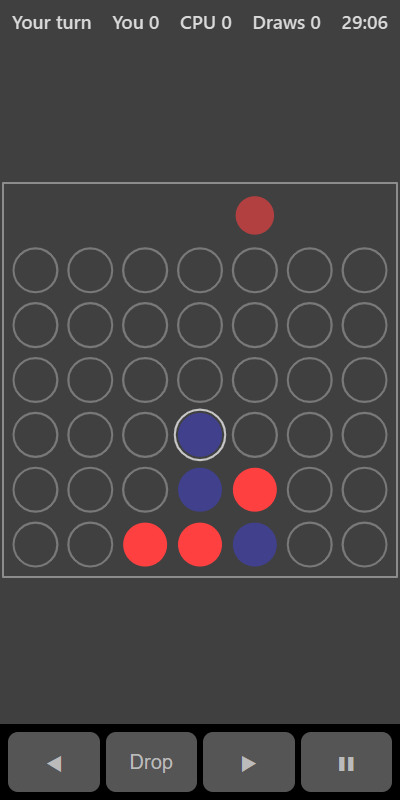

[Home](../../README.md) > [Strategy](README.md) > Four in a Row

Four in a Row is played on an upright board with 7 columns. You and the computer take turns dropping a disc into a column. Discs fall to the lowest empty space. The first to get four discs in a line across, down or diagonally wins.

## How to play

1. Tap **Play**.
2. On your turn, tap a column (or pick one with the arrows) to drop a disc into it.
3. The computer then drops its disc.
4. Four in a line wins the round. If the board fills up with no line, it's a draw.
5. A new round starts automatically, with the other player going first.

## Controls

| Action          | Touch           | Keyboard       | Controller |
|-----------------|-----------------|----------------|------------|
| Choose a column | Tap it, or ◀ ▶  | Left and Right | D-pad      |
| Drop a disc     | **Drop**        | Space or Enter | A          |
| Pause           | ❚❚              | P or Escape    | Start      |

## What each eye sees

| Weaker eye  | Stronger eye          | Both eyes                              |
|-------------|-----------------------|----------------------------------------|
| Your discs  | The computer's discs  | The empty slots and a ring on the last move |

## Difficulty

| Setting | How far ahead the computer looks | Chance of a random move |
|---------|----------------------------------|-------------------------|
| Easy    | 2 moves                          | 30%                     |
| Normal  | 4 moves                          | 5%                      |
| Hard    | 5 moves                          | None                    |

## Scoring

The top bar shows whose turn it is and your wins, losses and draws.

## Tips

* The middle column is the most useful. Use it early.
* Watch for the computer setting up two threats at once. Block before it gets three in a row with both ends open.
