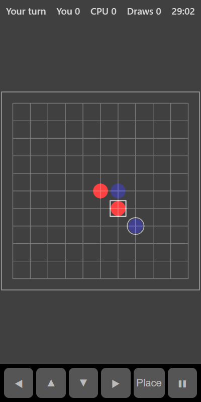

[Home](../../README.md) > [Strategy](README.md) > Gomoku

Gomoku is like a bigger Tic Tac Toe. On an 11 by 11 board, you and the computer take turns placing stones. The first to get five in an unbroken line across, down or diagonally wins.

## How to play

1. Tap **Play**.
2. On your turn, tap an empty point to place a stone.
3. The computer then places its stone.
4. Five in a row wins the round. If the board fills up first, it's a draw.
5. A new round starts automatically, with the other player going first.

## Controls

| Action             | Touch         | Keyboard       | Controller |
|--------------------|---------------|----------------|------------|
| Place a stone      | Tap the point | Space or Enter | A          |
| Move the selection | ◀ ▲ ▼ ▶       | Arrow keys     | D-pad      |
| Pause              | ❚❚            | P or Escape    | Start      |

## What each eye sees

| Weaker eye   | Stronger eye           | Both eyes    |
|--------------|------------------------|--------------|
| Your stones  | The computer's stones  | The board    |

## Difficulty

The computer weighs up attacking and defending on every move. On Easy it defends less and its choices are more random. On Hard it always blocks your strongest line.

## Scoring

The top bar shows whose turn it is and your wins, losses and draws.

## Tips

* An open line of three (with space at both ends) is a big threat. Block it straight away.
* Try to build two lines at once so the computer can only block one.
