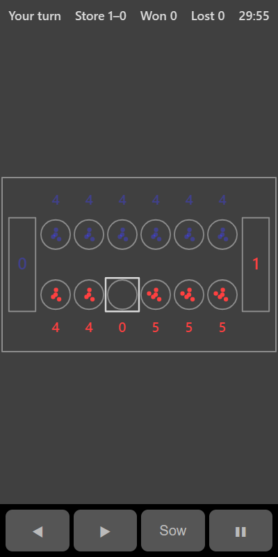

[Home](../../README.md) > [Strategy](README.md) > Mancala

Mancala is one of the oldest board games in the world. This version is known as Kalah. The board has two rows of six pits, each starting with four stones, and a store at each end. Your pits are the bottom row and your store is on the right. The computer has the top row and the store on the left. Get more stones into your store than the computer does.

## How to play

1. Tap **Play**.
2. On your turn, tap one of your pits that has stones in it.
3. All its stones are picked up and sown one at a time into the following pits, going anticlockwise: along your row to the right, into your store, then along the computer's row. The computer's store is skipped.
4. If your last stone lands in your store, you take another turn.
5. If your last stone lands in an empty pit on your side, and the computer's pit opposite has stones in it, you capture both lots into your store.
6. The round ends when either player's row is empty. Any stones left in the other row go to that player's store.
7. The player with more stones in their store wins the round. A new round starts automatically, with the other player going first.

## Controls

| Action           | Touch          | Keyboard       | Controller |
|------------------|----------------|----------------|------------|
| Sow from a pit   | Tap the pit    | Space or Enter | A          |
| Choose a pit     | ◀ ▶            | Left and Right | D-pad      |
| Pause            | ❚❚             | P or Escape    | Start      |

## What each eye sees

| Weaker eye                               | Stronger eye                                   | Both eyes                                   |
|------------------------------------------|------------------------------------------------|---------------------------------------------|
| Your stones, pit counts and store count  | The computer's stones, pit counts and store count | The pits, stores and a ring on the last pit sown |

## Difficulty

| Setting | How far ahead the computer looks | Random moves  |
|---------|----------------------------------|---------------|
| Easy    | 2 moves                          | Half the time |
| Normal  | 4 moves                          | None          |
| Hard    | 6 moves                          | None          |

## Scoring

The top bar shows whose turn it is, the store totals, and your wins and losses.

## Tips

* Look for a pit with exactly the right number of stones to finish in your store. A pit with 1 stone next to your store, 2 stones two pits away, and so on, gives you another turn.
* Take extra turns first, then make your main move.
* Watch for empty pits on the computer's side opposite your full ones. The computer can capture them.
