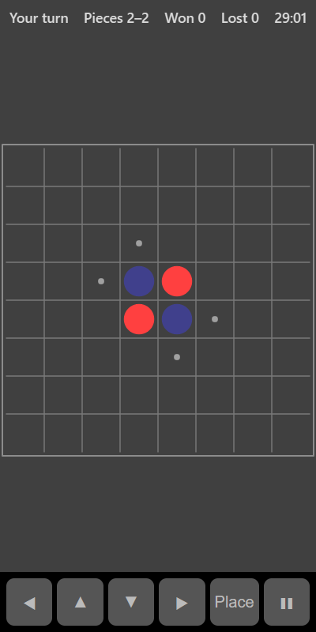

[Home](../../README.md) > [Strategy](README.md) > Reversi

Reversi (also called Othello) is played on an 8 by 8 board that starts with four pieces in the middle. Place a piece so that it traps one or more lines of the computer's pieces between it and another of your pieces. All the trapped pieces flip to your side. Whoever has more pieces when the board fills (or no one can move) wins.

## How to play

1. Tap **Play**.
2. Small dots show where you can play.
3. Tap one of the dotted squares. Every line of the computer's pieces you trap, across, down or diagonally, flips to your side.
4. The computer then plays.
5. If a player has no legal move, they miss their turn.
6. When neither player can move, the one with more pieces wins the round.

## Controls

| Action             | Touch          | Keyboard       | Controller |
|--------------------|----------------|----------------|------------|
| Place a piece      | Tap the square | Space or Enter | A          |
| Move the selection | ◀ ▲ ▼ ▶        | Arrow keys     | D-pad      |
| Pause              | ❚❚             | P or Escape    | Start      |

## What each eye sees

| Weaker eye   | Stronger eye           | Both eyes                      |
|--------------|------------------------|--------------------------------|
| Your pieces  | The computer's pieces  | The board and legal-move dots  |

## Difficulty

| Setting | How the computer plays                                         |
|---------|----------------------------------------------------------------|
| Easy    | Half the time it plays a random move, otherwise it flips the most pieces |
| Normal  | It picks the move that looks best right now                    |
| Hard    | It looks 3 moves ahead                                         |

## Scoring

The top bar shows whose turn it is, the piece count, and your wins and losses.

## Tips

* Corners can never be flipped. Take them when you can.
* Avoid the squares next to an empty corner. They often hand the corner to the computer.
* Flipping lots of pieces early isn't always good. Having more moves available matters more.
