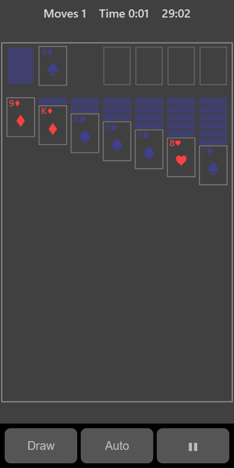

[Home](../../README.md) > [Strategy](README.md) > Solitaire

Solitaire is the classic one-player card game (also called Klondike or patience). Cards are dealt into seven columns. Move cards between the columns to uncover the face-down cards, and build each suit up from Ace to King on the four foundation spaces at the top right.

## Layout

| Area         | Where                     | What it's for                                         |
|--------------|---------------------------|-------------------------------------------------------|
| Deck         | Top left                  | Cards still to draw                                   |
| Waste        | Next to the deck          | Cards turned over from the deck. Only the top one can be played |
| Foundations  | Top right (four spaces)   | Build each suit here from Ace up to King              |
| Columns      | The seven piles below     | Build down here in alternating colours                |

## How to play

1. Tap **Play**. The timer starts.
2. Tap a face-up card, then tap where it should go.
3. In the columns, a card can go on a card one rank higher of the opposite colour, for example a red 6 on a black 7. You can move a whole run of face-up cards together.
4. Only a King can go into an empty column.
5. On the foundations, start with an Ace and add the same suit in order: 2, 3 and so on up to King.
6. When you move the last face-up card off a column, the card under it turns over.
7. Tap the deck (or **Draw**) to turn over more cards. When the deck is empty, tap it again to turn the waste back into the deck.
8. You win when all four suits are complete.

## Controls

| Action                       | Touch                                   | Keyboard       | Controller |
|------------------------------|-----------------------------------------|----------------|------------|
| Select a card                | Tap it                                  | None           | None       |
| Move the selected card       | Tap where it should go                  | None           | None       |
| Send a card where it fits    | Tap the selected card again             | None           | None       |
| Draw from the deck           | Tap the deck, or **Draw**               | Space or Enter | A          |
| Send all possible cards to the foundations | **Auto**                  | X              | B          |
| Pause                        | ❚❚                                      | P or Escape    | Start      |

Moving cards needs touch, so Solitaire can't be played fully in split-screen mode with a controller.

## What each eye sees

| Weaker eye  | Stronger eye                        | Both eyes         |
|-------------|-------------------------------------|-------------------|
| Red cards   | Black cards and face-down cards     | Card outlines     |

Building columns in alternating colours means you are always matching a card from one eye with a card from the other.

## Difficulty

| Setting | Cards turned from the deck each time |
|---------|--------------------------------------|
| Easy    | 1                                    |
| Normal  | 1                                    |
| Hard    | 3                                    |

## Scoring

Solitaire isn't played against the computer. Your time is your score, and the top bar shows your moves and time. Your best is your fastest win.

## Tips

* Turn over face-down cards in the columns whenever you can. They are what blocks you.
* Don't empty a column unless you have a King ready to put in it.
* Use **Auto** near the end to finish quickly.
