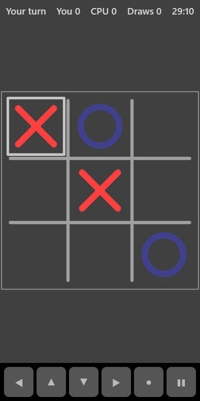

[Home](../../README.md) > [Strategy](README.md) > Tic Tac Toe

Tic Tac Toe (also called noughts and crosses) is played on a 3 by 3 grid. You are X and the computer is O. Take turns placing a mark. The first to get three in a row across, down or diagonally wins.

## How to play

1. Tap **Play**. The top bar shows **Your turn** or **Computer…**.
2. On your turn, tap an empty square to place your X.
3. The computer then places its O.
4. Three in a row wins the round. If the board fills with no line, it's a draw.
5. A new round starts automatically, with the other player going first.

## Controls

| Action             | Touch          | Keyboard       | Controller |
|--------------------|----------------|----------------|------------|
| Place a mark       | Tap the square | Space or Enter | A          |
| Move the selection | ◀ ▲ ▼ ▶        | Arrow keys     | D-pad      |
| Pause              | ❚❚             | P or Escape    | Start      |

## What each eye sees

| Weaker eye    | Stronger eye          | Both eyes     |
|---------------|-----------------------|---------------|
| Your X marks  | The computer's O marks | The grid lines |

## Difficulty

| Setting | How often the computer makes a random move |
|---------|--------------------------------------------|
| Easy    | 60% of the time                            |
| Normal  | 25% of the time                            |
| Hard    | Never. It can't be beaten, only drawn      |

## Scoring

The top bar shows whose turn it is and your wins, losses and draws.

## Tips

* If you go first, take the centre or a corner.
* Always block the computer when it has two in a row.
