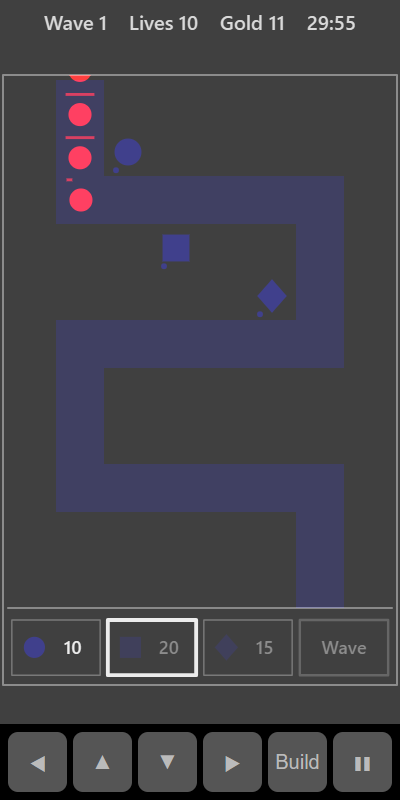

[Home](../../README.md) > [Strategy](README.md) > Tower Defence

Tower Defence has a winding road from the top of the board to the bottom. Waves of invaders march down it. Build towers beside the road to shoot them before they reach the bottom. Each invader you stop earns gold to build and upgrade more towers. The waves keep coming, and each one is tougher than the last. How many can you hold off?

## How to play

1. Tap **Play**. You start in a build break with some gold. The **Go** box counts down to the first wave.
2. Choose a tower from the bar at the bottom. Its cost is shown beside it.
3. Tap an empty square beside the road to build it there. You can't build on the road.
4. Tap **Go** to send the wave early, or wait for the countdown.
5. Towers fire by themselves at the invader furthest down the road within range.
6. Each invader you stop earns gold. You also get a bonus at the end of each wave.
7. Between waves, build more towers or tap a tower to upgrade it. A ring shows its range.
8. Each invader that reaches the bottom costs a life. The game ends when you run out of lives.

## Towers

| Tower  | Shape   | Cost | What it does                                                    |
|--------|---------|------|-----------------------------------------------------------------|
| Bolt   | Circle  | 10   | Fast single shots. Good all-rounder                             |
| Cannon | Square  | 20   | Slow, heavy shots that also hit everything close to the target  |
| Frost  | Diamond | 15   | Weak shots that slow an invader to half speed for a moment      |

Each tower can be upgraded twice. Each level makes it hit harder and reach further. The dots under a tower show its level. The first upgrade costs the same as the tower, and the second costs double.

## Invaders

| Invader | Shape    | What to know                                             |
|---------|----------|----------------------------------------------------------|
| Normal  | Circle   | Steady speed                                             |
| Runner  | Triangle | Fast but fragile. Comes in groups every third wave       |
| Tank    | Square   | Slow but very tough. Appears from wave 4, more often later |

The bar above each invader shows how much health it has left. Slowed invaders turn pale blue.

## Controls

| Action                    | Touch                       | Keyboard       | Controller |
|---------------------------|-----------------------------|----------------|------------|
| Build or upgrade          | Tap a square or tower       | Space or Enter | A          |
| Choose a tower, or Go     | Tap the bar at the bottom   | Space or Enter on the bar | A on the bar |
| Move the selection        | ◀ ▲ ▼ ▶                     | Arrow keys     | D-pad      |
| Pause                     | ❚❚                          | P or Escape    | Start      |

With a keyboard or controller, move the white square below the board to reach the tower bar and **Go**.

## What each eye sees

| Weaker eye                         | Stronger eye                          | Both eyes                     |
|------------------------------------|---------------------------------------|-------------------------------|
| The invaders and their health bars | The road, your towers and their shots | The tower bar and range rings |

To defend well you have to see where the invaders are (weaker eye) in relation to your towers and the road (stronger eye).

## Difficulty

| Setting | Starting gold | Lives | Break between waves | Invader toughness              |
|---------|---------------|-------|---------------------|--------------------------------|
| Easy    | 60            | 15    | 20 seconds          | Lower, and grows more slowly   |
| Normal  | 50            | 10    | 15 seconds          | Medium                         |
| Hard    | 40            | 6     | 10 seconds          | Higher, and grows more quickly |

## Scoring

Your score is the number of waves you have cleared. The top bar shows the wave, your lives and your gold.

## Tips

* Build on the inside of the bends. A tower there can reach two or three stretches of road.
* Put Frost towers early on the road so the invaders are slowed down as they walk past your other towers.
* Cannons are best where invaders bunch up, especially for the groups of runners.
* Upgrading a well-placed tower is often better value than building a new one in a poor spot.
