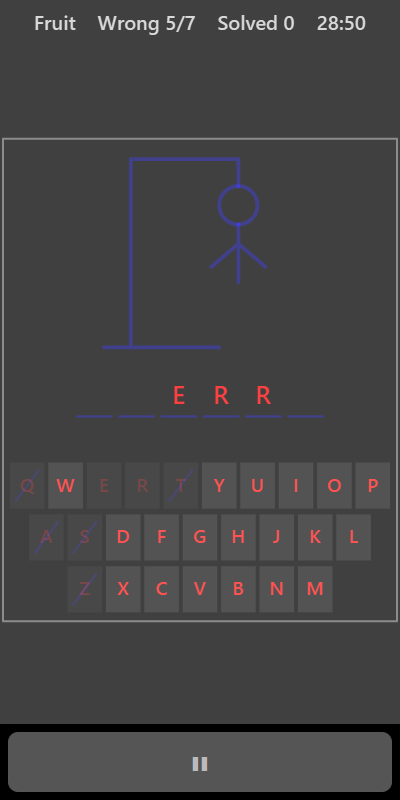

[Home](../../README.md) > [Words](README.md) > Hangman

Hangman hides a word from a theme, shown as a row of blanks. Guess one letter at a time. Correct letters fill in their blanks. Each wrong guess adds a piece to the drawing. Find the word before the drawing is complete.

## How to play

1. Tap **Play**. The theme is shown in the top bar.
2. Tap a letter on the keyboard to guess it.
3. If the letter is in the word, it appears in every blank where it belongs.
4. If it isn't, a piece is added to the drawing and the key is crossed out.
5. Fill in every letter to solve the word.
6. If the drawing is finished first, the answer is shown.
7. A new word appears after a few seconds.

## Controls

| Action        | Touch                         | Keyboard    | Controller |
|---------------|-------------------------------|-------------|------------|
| Guess a letter| Tap the on-screen keyboard    | A to Z      | None       |
| Pause         | ❚❚                            | Escape      | Start      |

In split-screen mode use a Bluetooth keyboard.

## What each eye sees

| Weaker eye                       | Stronger eye                                       | Both eyes      |
|----------------------------------|----------------------------------------------------|----------------|
| The letters (in the word and on the keys) | The blanks, the drawing and crosses on wrong keys | Key outlines   |

## Difficulty

| Setting | Wrong guesses allowed |
|---------|-----------------------|
| Easy    | 10                    |
| Normal  | 7                     |
| Hard    | 6                     |

With fewer wrong guesses allowed, more of the drawing is already there when the word starts.

## Scoring

The top bar shows the theme, your wrong guesses out of the number allowed, and how many words you have solved.

## Tips

* Start with vowels (A, E, I, O, U) and common letters like R, S, T and N.
* Think about the theme. Once you have a couple of letters, try to picture words from that theme that fit.
