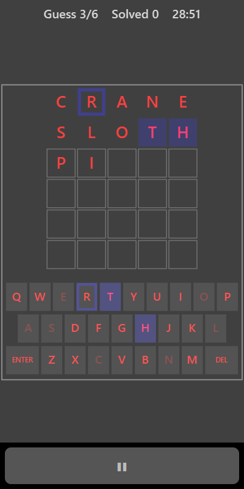

[Home](../../README.md) > [Words](README.md) > Word Guess

Word Guess hides a five-letter word. You have six tries to guess it. After each guess, every letter gets a clue telling you whether it's in the right place, in the word but somewhere else, or not in the word at all.

## How to play

1. Tap **Play**.
2. Type a five-letter word and press **ENTER**.
3. Read the clues on each letter:

   | Clue           | Meaning                                       |
   |----------------|-----------------------------------------------|
   | Solid square   | Right letter in the right place               |
   | Outline        | The letter is in the word, but somewhere else |
   | No mark        | The letter isn't in the word                  |

4. The on-screen keyboard shows the same clues. Letters that aren't in the word are dimmed.
5. Use the clues to make your next guess.
6. Guess the word within six tries to solve it. If you don't, the answer is shown.
7. A new word appears after a few seconds.

## Controls

| Action        | Touch                            | Keyboard     | Controller |
|---------------|----------------------------------|--------------|------------|
| Type a letter | Tap the on-screen keyboard       | A to Z       | None       |
| Delete        | **DEL**                          | Backspace    | None       |
| Submit        | **ENTER**                        | Enter        | None       |
| Pause         | ❚❚                               | Escape       | Start      |

In split-screen mode use a Bluetooth keyboard.

## What each eye sees

| Weaker eye                   | Stronger eye                       | Both eyes                    |
|------------------------------|------------------------------------|------------------------------|
| The letters you type         | The clues (solid squares and outlines) | Empty boxes and key outlines |

You need both eyes to link each letter with its clue.

## Difficulty

Word Guess is the same on every difficulty setting.

## Scoring

The top bar shows the guess number (or a message) and how many words you have solved.

## Tips

* Start with a word that has common letters, such as CRANE or SLATE.
* Use your second guess to try five new letters rather than reusing ones you already know about.
